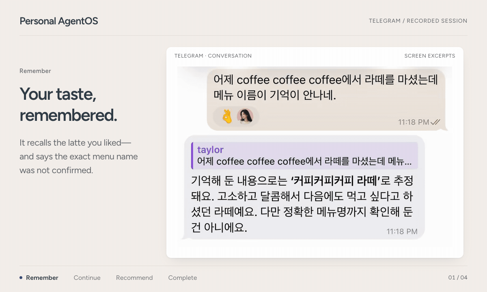
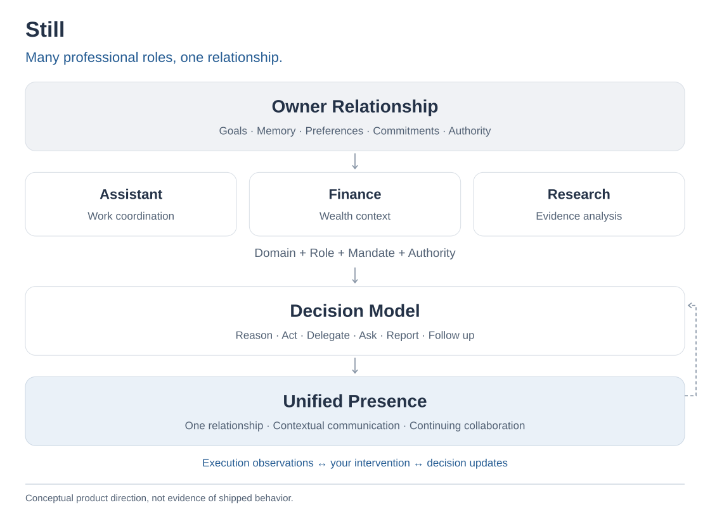
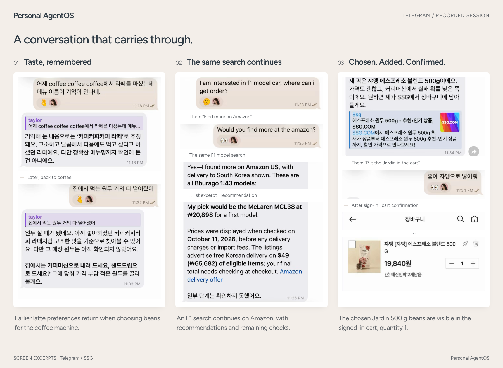

<div align="center">

<pre>
   ________________   __ 
  / __/_  __/  _/ /  / / 
 _\ \  / / _/ // /__/ /__
/___/ /_/ /___/____/____/
</pre>

**Your personal agent, on your own machine.<br>Change the AI underneath; keep its memory, open work and permissions.**

[](https://github.com/Jongtae/Still/actions/workflows/validate.yml) [](https://github.com/Jongtae/Still/actions/workflows/full-validate.yml) [](https://github.com/Jongtae/Still/releases) [](pyproject.toml) [](docs/QUICKSTART.md) [](LICENSE)

[English](README.md) | [한국어](docs/i18n/README.ko.md) | [简体中文](docs/i18n/README.zh-CN.md) | [日本語](docs/i18n/README.ja.md)

[What it does](#what-it-does-today) · [Quick start](#quick-start) · [What stays yours](#what-stays-yours) · [Docs](#documentation) · [Engineering](https://jongtae.github.io/Still/engineering/index.html)

</div>

<!-- readme-parity:v1 -->

<!-- readme-section:hero -->

## Your AI can change. Your assistant stays.

Most of us won't own the AI models we use; their makers can change prices, rules and availability at any time. Still is an open-source assistant you install on your own computer. It keeps what it knows about you, your unfinished work and your permissions there, while the AI doing the work, the one you already subscribe to, can change.

<p align="center">
  
</p>
<p align="center"><sub>Edited from real recordings.</sub></p>

<!-- readme-section:ai-switch -->

## A conversation that continues when the AI changes

<p align="center">
  
</p>
<p align="center"><sub>Excerpts from a real conversation (Telegram, Korean UI). The sign-in link is cropped out and the name is blurred. · <a href="docs/assets/readme/ai-switch/ai-switch-conversation.png">Open full size</a></sub></p>

After switching to Claude Code, the PA picks up yesterday's shopping conversation and checks the cart. After switching to Codex, “take the Spam out” works in the same conversation.

*Recorded owner session; edited, Korean interface. This shows conversation continuity, not independent verification of cart effects or release-wide validation.* [Sources](https://github.com/Jongtae/Still/blob/main/docs/assets/readme/ai-switch/manifest.json)

<!-- readme-section:capabilities -->

## What it does today

- **Works with the AI you already pay for.** Your ChatGPT plan through Codex or your Claude plan through Claude Code does the work; an API key or [Ollama](https://ollama.com) also works. Switch with `/ai` in the middle of a conversation and it carries on.
- **Chat in the terminal, browser or messenger.** In the terminal and the browser, on Telegram, and in a Slack or Mattermost direct message.
- **Uses earlier conversations to help with later requests.** What you told it last week comes back when it matters. Once a day it looks back over recent requests to tidy its memory, and each fact says whether it rests on your own words or on an inference. Every save can be undone.
- **Uses the folders and services you connect.** Folders you connect (read-only unless you say otherwise), Gmail search and, if you allow it, mailbox organising (it never sends), Google Calendar and Drive, and websites you sign in to, even from your phone.
- **Accepts questions and corrections while a task runs.** It tells you its plan and which AI is on it before a long task. Ask something else while it runs, or correct it halfway.
- **Requires your approval for every payment and protects secrets.** Every payment needs your yes. [Secrets](.github/SECURITY.md) never reach a prompt or a log. Each task lists which of your information it used and where it went.

Some of this still has rough edges; [product status](docs/product-status.en.md) says which.

<!-- readme-section:try-today -->

## Quick start

You need a Mac, Linux or Windows with [WSL2](docs/QUICKSTART.md#windows-wsl2) (some limits), and one AI: a ChatGPT plan with the [Codex CLI](https://github.com/openai/codex), a Claude plan with [Claude Code](https://code.claude.com/docs/en/setup), an API key, or Ollama. One command installs and starts Still, with no Homebrew, Python or Docker needed:

```sh
curl -LsSf https://raw.githubusercontent.com/Jongtae/Still/ebf97d4150be3eb867649a31e79287f05db02886/scripts/install.sh | sh
```

[Inspect the script](https://github.com/Jongtae/Still/blob/ebf97d4150be3eb867649a31e79287f05db02886/scripts/install.sh) first; it verifies everything it downloads. On Windows, run `wsl --install` in PowerShell, restart, and run the command in Ubuntu. With [Homebrew](https://brew.sh) on an Apple silicon Mac instead (Homebrew no longer builds packages for Intel Macs, so use the command above there):

```sh
brew tap jongtae/still https://github.com/Jongtae/Still
brew install jongtae/still/agentos
agentos start
```

1. Setup runs in the terminal: an optional password, then your AI (a signed-in one is preselected). Talk to Still right there, or on the Still screen at [http://127.0.0.1:8787](http://127.0.0.1:8787/). Keep `agentos start` running while you talk, or on a Mac run `agentos service install` once to keep it running in the background ([details](docs/QUICKSTART.md#background-service-macos)).
2. For Telegram, say “connect Telegram”, paste your @BotFather token into the hidden prompt, open the pairing link and press Start.
3. Ask for something real: **“My cat has been off her food lately. What should I try?”** Days later, **“Find me a robot vacuum under $500.”** It remembers the cat.

Every setting, Windows details and uninstalling (`agentos uninstall` keeps your data unless you choose otherwise) are in [QUICKSTART](docs/QUICKSTART.md).

**Release status:** both installers install **v0.4.0** (2026-11-01), built from the tagged main commit. The demo and the everyday-use image come from real sessions and are not release-specific end-to-end validation; the architecture figure is product direction. The [release manifest](docs/release-manifest.json) records what each release covers, and [product status](docs/product-status.en.md) separates shipped behavior, test evidence and direction.

<!-- readme-section:ownership -->

## What stays yours

| Can change | Stays with you |
| --- | --- |
| The model and its provider | Memory and context about you |
| The CLI agent or API doing the work | Open work and its next step |
| Tools and connectors | Permissions and approvals |
| | The record of what actually ran |

When a better AI appears, you switch the worker, not the agent. Local-first is not local-only: your subscription AI runs at OpenAI or Anthropic, so the context used for a request is sent to that provider. Five principles guide the project: presence, portable memory, model independence, execution and owner control ([why](docs/VISION.md)).

<!-- readme-section:presence -->

## How it works

<details>
<summary>Architecture and supporting screens</summary>

<picture>
  <source media="(max-width: 600px)" srcset="docs/assets/readme/presence-overview.en.narrow.svg">
  
</picture>

</details>

Still keeps one relationship with you (your goals, memory, preferences and permissions), reads each request through the role it calls for, and decides whether to answer, act, ask or report back. What you say while it works changes the work in progress. The figure shows the intended design, not an observed run: [architecture](docs/personal-agentos-architecture.en.md) · [Presence](docs/presence-experience-contract.en.md).

<!-- readme-section:conversation -->

## Everyday use

*Excerpts from real Telegram sessions (Korean interface), arranged with short scene notes.*

<details>
<summary>Architecture and supporting screens</summary>

<picture>
  <source media="(max-width: 600px)" srcset="docs/assets/readme/readme-examples-v4.en.png">
  
</picture>

</details>

A latte you mentioned earlier comes back when you choose beans; an F1 model search continues on Amazon without being restated; the chosen beans show up in the signed-in cart. Adding to a cart and paying stay different actions.

<!-- readme-section:engineering -->

## Engineering

Explore how Still keeps memory and work, makes decisions, and handles user permissions. The guide separates implemented features, what has been verified, and future design, with links to the source documents and code.

[Why this design?](https://jongtae.github.io/Still/engineering/index.html) · [Research & Evidence](https://jongtae.github.io/Still/engineering/index.html#research)

<!-- readme-section:more -->

## Documentation

[QUICKSTART](docs/QUICKSTART.md) (install, connections, Telegram, Slack, running from source) · [Product status](docs/product-status.en.md) · [Why this exists](docs/VISION.md) · [Architecture](docs/personal-agentos-architecture.en.md) · [Documentation map](docs/README.md) · [Acknowledgements](docs/acknowledgements.en.md)

**Contributing.** Issues and pull requests are welcome: start with [CONTRIBUTING](.github/CONTRIBUTING.md) and the [contributor onboarding guide](docs/contributor-onboarding.en.md). Tried it? Tell us what worked through the [feedback form](https://github.com/Jongtae/Still/issues/new?template=feedback.yml) or [Discussions](https://github.com/Jongtae/Still/discussions).

<!-- readme-section:license -->

## License

[AGPL-3.0-only](LICENSE). The Still name and logo follow the [trademark notice](docs/TRADEMARKS.md).
