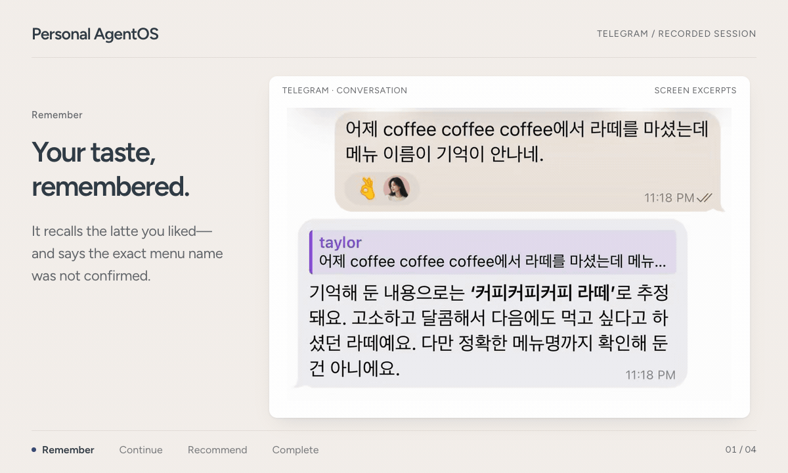
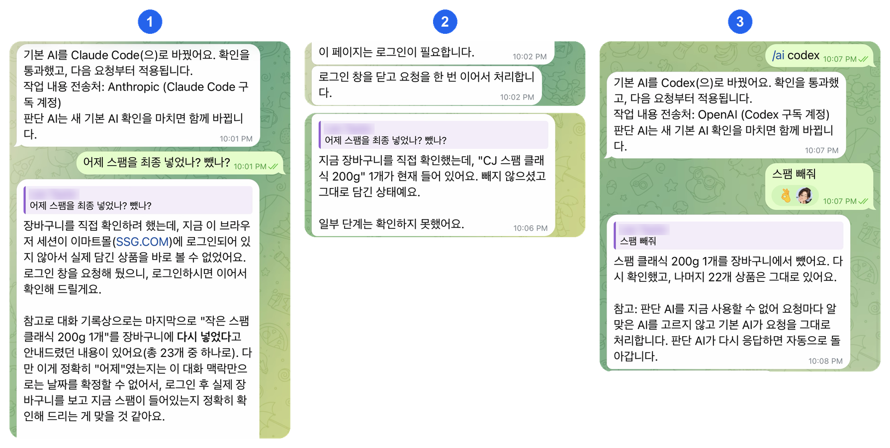
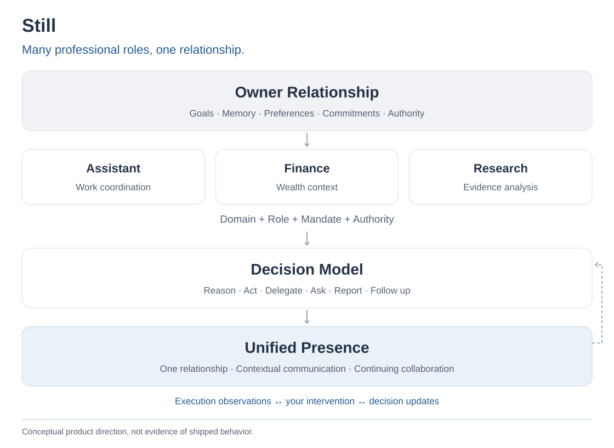
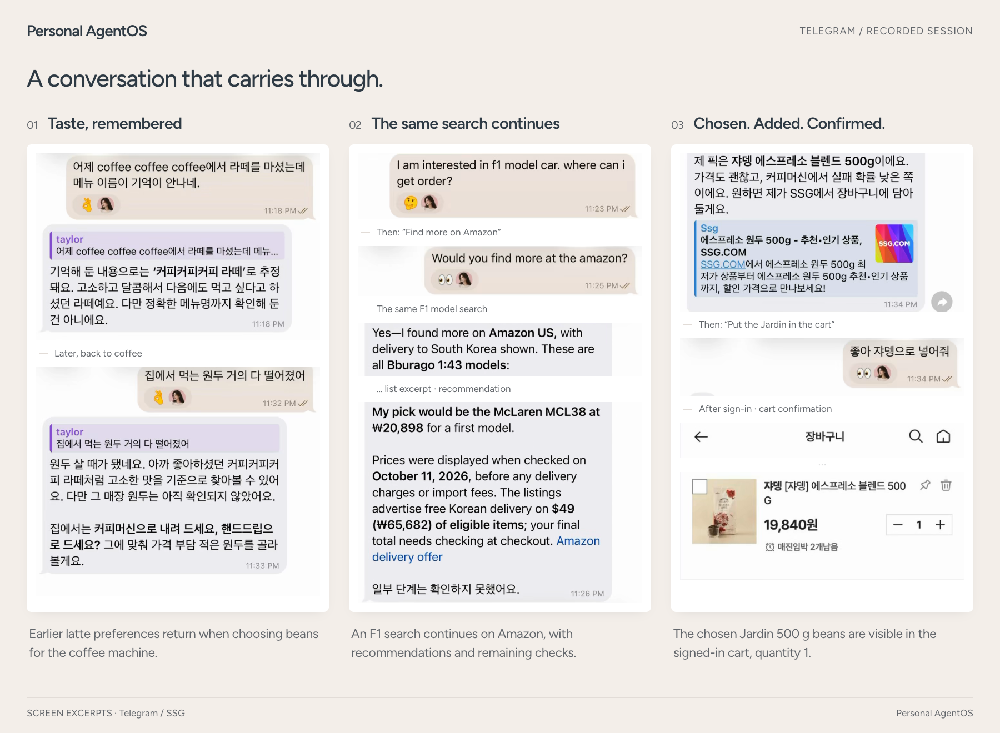

<div align="center">

<pre>
   ________________   __ 
  / __/_  __/  _/ /  / / 
 _\ \  / / _/ // /__/ /__
/___/ /_/ /___/____/____/
</pre>

**Change your AI. Keep your assistant.**

An open-source personal assistant on your own computer.

[](https://github.com/Jongtae/Still/releases) [](https://github.com/Jongtae/Still/actions/workflows/validate.yml) [](docs/QUICKSTART.md) [](LICENSE)

[English](README.md) | [한국어](docs/i18n/README.ko.md) | [简体中文](docs/i18n/README.zh-CN.md) | [日本語](docs/i18n/README.ja.md)

[Try it](#quick-start) · [What it does](#what-it-does-today) · [Your data](#what-stays-yours) · [Give feedback](#documentation) · [Engineering](https://jongtae.github.io/Still/engineering/index.html)

</div>

<!-- readme-parity:v1 -->

<!-- readme-section:hero -->

## Why start over with every new AI?

Your preferences. Yesterday's conversation. The work you haven't finished. Changing the AI that helps you shouldn't mean starting from scratch.

**Still keeps your memory, ongoing work and permissions on your computer, separate from the AI doing the work.** Connect Codex, Claude Code, a model API or Ollama. The worker can change; the assistant's context stays with you.

<p align="center">
  
</p>
<p align="center"><sub>Edited from real Telegram and browser recordings. <a href="docs/assets/readme/demo/README.md">Recording notes</a>.</sub></p>

<!-- readme-section:ai-switch -->

## A conversation that continues when the AI changes

In the recorded session below, the user switches to Claude Code and asks about yesterday's shopping conversation. Later, after switching to Codex, they say “take the Spam out.” Still follows the same conversation instead of asking them to explain it again.

<details>
<summary>See the actual model-switch conversation</summary>

<p align="center">
  
</p>

The sign-in link is cropped out and the name is blurred. [Open full size](docs/assets/readme/ai-switch/ai-switch-conversation.png) · [Recording manifest](docs/assets/readme/ai-switch/manifest.json).

</details>

*This is an edited owner session, in Korean. It shows conversation continuity, not independent verification of cart changes or release-wide repeatability.*

<!-- readme-section:try-today -->

## Quick start

You need **macOS, Linux or Windows with [WSL2](docs/QUICKSTART.md#windows-wsl2)**, plus one configured AI connection: Codex, Claude Code, an API or an already running Ollama server. Subscription routes need the appropriate CLI access and sign-in; AI subscriptions, API usage and model downloads are separate from Still. See [AI setup](docs/QUICKSTART.md#connect-an-ai).

Inspect the [pinned installer](https://github.com/Jongtae/Still/blob/33e12cea89fccad49118600ff47106e1c6f16350/scripts/install.sh), then run this in a macOS or Linux terminal, or inside Ubuntu on WSL2:

```sh
curl -LsSf https://raw.githubusercontent.com/Jongtae/Still/33e12cea89fccad49118600ff47106e1c6f16350/scripts/install.sh | sh
```

No preinstalled Python, Homebrew or Docker is needed. The installer supplies its Python environment and checks the release archive against the recorded SHA-256.

Choose your AI in terminal setup. Then talk to Still in that terminal or open [http://127.0.0.1:8787/](http://127.0.0.1:8787/) on the same computer. **You do not need to connect email, a calendar or a messenger to start.**

### Try one small conversation

Paste a short, non-sensitive paragraph and ask: **“Summarize this in three sentences.”** Follow with **“Make it shorter, but keep the important dates.”** These are suggested first requests, not a recorded test result. Check the answer and whether the follow-up uses the same context. Once that works, try a low-risk task you actually want help with.

For Telegram, say “connect Telegram” and follow the pairing steps. Enter the bot token only in the dedicated hidden input, never in an ordinary message.

Keep `agentos start` running and the computer awake for remote requests and scheduled work. On macOS, `agentos service install` can register a background login service; installation alone does not do this. [Running and restarting](docs/guide/operations.en.md#background-service-macos).

<details>
<summary>Prefer Homebrew on an Apple silicon Mac?</summary>

```sh
brew tap jongtae/still https://github.com/Jongtae/Still
brew install jongtae/still/agentos
agentos start
```

For Intel Macs, use the one-line installer above. The command is still called `agentos` for compatibility; it starts Still.

</details>

**Release status:** both installers install **v0.7.0** (2026-11-13), built from the tagged main commit. The demo and the everyday-use image come from real sessions and are not release-specific end-to-end validation; the architecture figure is product direction. See the [release manifest](docs/release-manifest.json) for the release's exact coverage and evidence limits.

Setup, Windows limitations, updates and removal: [QUICKSTART](docs/QUICKSTART.md).

<!-- readme-section:capabilities -->

## What it does today

| What you want | What Still provides |
| --- | --- |
| Continue without explaining everything again | Saved memory and earlier context for later requests; inspect and correct what it remembers. |
| Use a different AI | Switch the connected AI with `/ai` while keeping Still's memory and work records. |
| Work with your own information | Connected folders, Google Drive, Gmail search and separately authorized mailbox organization, and Google Calendar. Gmail sending is not supported. |
| Get help on a website | Browser tools for sites you sign in to. Compatibility and sign-in requirements vary by site and platform. |
| Change your mind while it works | Ask an independent question or correct a request during an ongoing task. |
| Talk where you prefer | Terminal, browser, Telegram, and Slack or Mattermost direct messages. |

Still is in active development. Start with a small task and add connections when you need them. Model choice, permissions, service setup and website behavior affect the result; this is not a promise that every workflow works on every model or site. [Product status](docs/product-status.en.md) separates implementation, observed use and product direction; use the release manifest above for exact release scope.

<!-- readme-section:ownership -->

## What stays yours

The AI does the work. Still keeps the state that should not disappear when you change it: **memory and context, unfinished work, permissions and approvals, and the record of what ran.** Keeping that state does not guarantee identical answers or tool support across models.

**Local-first is not local-only.** When you use an external AI, the conversation and context needed for the request are sent to that provider. Connecting a remote service does not put that service's data retention under Still's control. Start with non-sensitive material and connect only the folders and accounts you intend to use.

### Permissions and payments

Connected folders are read-only unless you grant write access. Authorization rules differ by action; connecting a service does not mean every change has a separate confirmation. Still keeps an information-use record for each task. Use dedicated credential inputs, not chat messages, for passwords and tokens. See [security and secret handling](.github/SECURITY.md).

**Payments require per-action approval by default. Payment autonomy is off by default.** If you explicitly turn it on, your AI may make payments and money movements without asking each time, including from scheduled work. While enabled, this mode currently has **no amount, period or per-connection caps**. Leave it off for a first trial. Its inclusion in the release is not evidence of a verified live payment or securities-order journey. See the [release manifest](docs/release-manifest.json) before using it.

<!-- readme-section:presence -->

## How it works

Still separates the assistant's durable state from the AI executing a request. The aim is one continuing conversation—not a different assistant every time a worker or tool changes.

You do not need to understand the internal architecture to try it. The [engineering guide](https://jongtae.github.io/Still/engineering/index.html) explains the design, implementation and evidence separately.

<details>
<summary>Explore the architecture and product direction</summary>

<picture>
  <source media="(max-width: 600px)" srcset="docs/assets/readme/presence-overview.en.narrow.svg">
  
</picture>

This figure describes the intended design, not an observed run or a claim that every illustrated role is a shipped specialist agent. [Architecture](docs/personal-agentos-architecture.en.md) · [Presence](docs/presence-experience-contract.en.md) · [Why Still exists](docs/VISION.md).

</details>

<!-- readme-section:conversation -->

## Everyday use

*Excerpts from real Telegram sessions (Korean interface), arranged with short scene notes.*

The recordings show a coffee preference used in a later recommendation, an F1 model search continued on Amazon, and a post-login reply about the selected beans in the cart. A cart reply is not an independent account-state check; adding to a cart and paying are different actions.

<details>
<summary>See more real conversation excerpts</summary>

<picture>
  <source media="(max-width: 600px)" srcset="docs/assets/readme/readme-examples-v4.en.png">
  
</picture>

</details>

<!-- readme-section:engineering -->

## Engineering

Interested in what makes continuity possible? Start with [Engineering](https://jongtae.github.io/Still/engineering/index.html) and [Research & Evidence](https://jongtae.github.io/Still/engineering/index.html#research). They cover memory, decisions, execution and owner control, with links to the underlying code and experiments. Designs, automated tests and observed live sessions are not interchangeable evidence.

<!-- readme-section:more -->

## Documentation

[QUICKSTART](docs/QUICKSTART.md) · [Product status](docs/product-status.en.md) · [Documentation map](docs/README.md) · [Contributing](.github/CONTRIBUTING.md) · [Contributor onboarding](docs/contributor-onboarding.en.md) · [Acknowledgements](docs/acknowledgements.en.md)

### Try it on something that matters to you

Still is looking for useful real-world feedback, not just a successful demo. Try one low-risk task and tell us: **Where did you get stuck? What did you have to explain twice? What would you ask it to do again tomorrow?**

Use the [feedback form](https://github.com/Jongtae/Still/issues/new?template=feedback.yml) or [Discussions](https://github.com/Jongtae/Still/discussions). Include your platform, Still version, AI connection and a redacted example. Do not post credentials, private documents or sign-in links. Report security issues through [SECURITY.md](.github/SECURITY.md), not a public issue.

<!-- readme-section:license -->

## License

[AGPL-3.0-only](LICENSE). The Still name and logo follow [TRADEMARKS.md](docs/TRADEMARKS.md).
