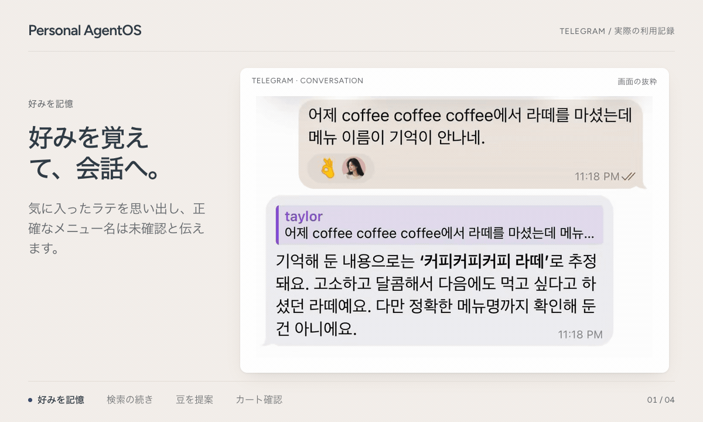
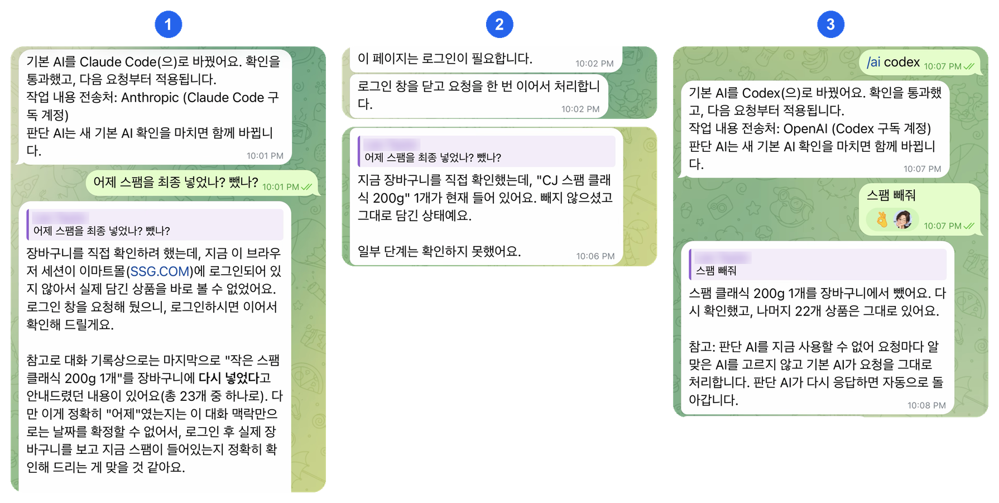
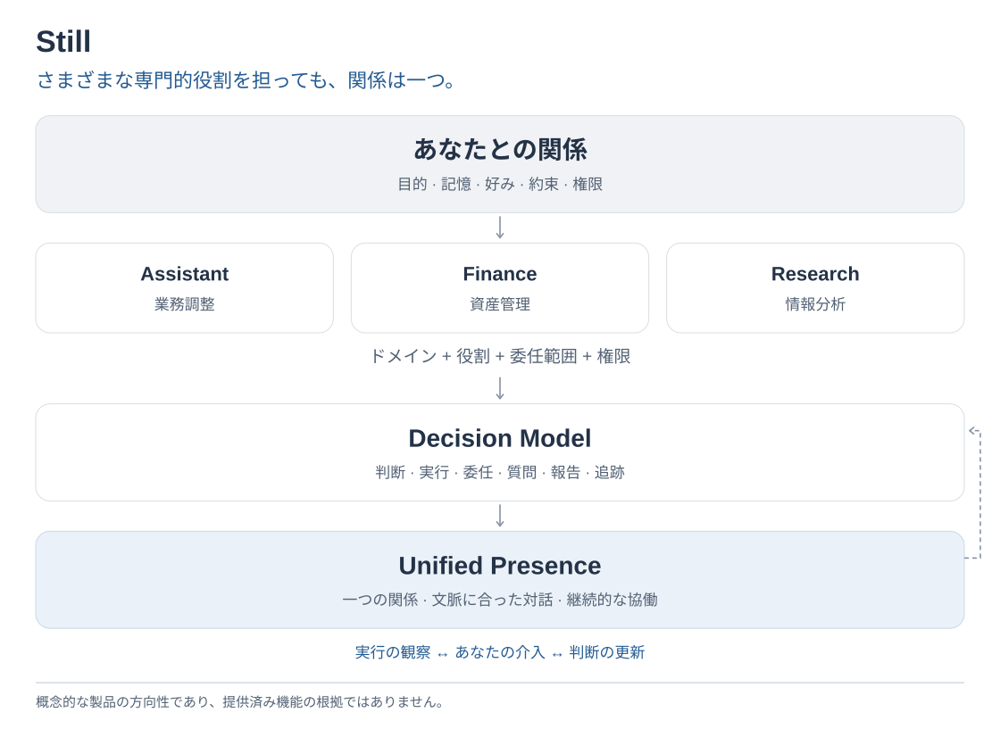
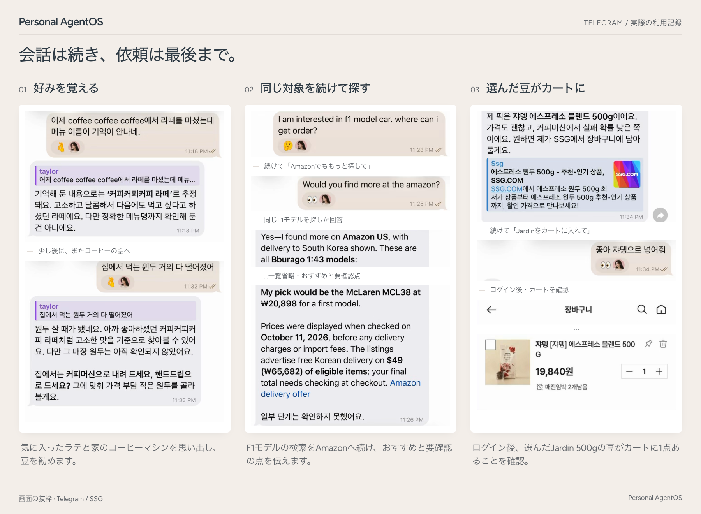

<div align="center">

<pre>
   ________________   __ 
  / __/_  __/  _/ /  / / 
 _\ \  / / _/ // /__/ /__
/___/ /_/ /___/____/____/
</pre>

**AI を替えても、あなたのアシスタントはそのまま。**

自分のコンピューターにインストールする、オープンソースのパーソナルアシスタント。

[](https://github.com/Jongtae/Still/releases) [](https://github.com/Jongtae/Still/actions/workflows/validate.yml) [](../../docs/QUICKSTART.md) [](../../LICENSE)

[English](../../README.md) | [한국어](README.ko.md) | [简体中文](README.zh-CN.md) | [日本語](README.ja.md)

[試してみる](#クイックスタート) · [いまできること](#いまできること) · [データと権限](#自分に残るもの) · [フィードバック](#ドキュメント) · [Engineering](https://jongtae.github.io/Still/engineering/ja.html)

</div>

<!-- readme-parity:v1 -->

<!-- readme-section:hero -->

## AI を替えるたびに、自分のことを説明し直しますか？

自分の好み。昨日の会話。まだ終わっていない仕事。より良い AI を使うために、すべてを最初からやり直す必要はないはずです。

**Still は、記憶、進行中の仕事、権限を、実際に働く AI から切り離して自分のコンピューターに残します。** Codex、Claude Code、モデル API、Ollama を接続できます。働く AI が変わっても、アシスタントが引き継ぐ文脈は手元に残ります。

<p align="center">
  
</p>
<p align="center"><sub>実際の Telegram とブラウザーの録画を編集しました。<a href="../../docs/assets/readme/demo/README.md">録画の記録</a>。</sub></p>

<!-- readme-section:ai-switch -->

## AI を替えても続く会話

下の記録では、ユーザーが Claude Code に切り替えて昨日の買い物の会話を尋ねます。その後 Codex に切り替えて「スパムを抜いて」と頼みます。Still は最初からの説明を求めず、同じ会話の文脈を引き継ぎます。

<details>
<summary>実際に AI を切り替えた会話を見る</summary>

<p align="center">
  
</p>

ログインリンクは切り取り、名前はぼかしています。[原寸で見る](../../docs/assets/readme/ai-switch/ai-switch-conversation.png) · [録画マニフェスト](../../docs/assets/readme/ai-switch/manifest.json)。

</details>

*韓国語で行った実際の利用セッションを編集した記録です。会話の継続を示すもので、カート変更の独立検証やリリース全体の再現性を証明するものではありません。*

<!-- readme-section:try-today -->

## クイックスタート

**macOS、Linux、または [WSL2](../../docs/QUICKSTART.md#windows-wsl2) を使う Windows** と、設定済みの AI 接続が一つ必要です。Codex、Claude Code、API、または起動済みの Ollama を使えます。サブスクリプション経由では、対応する CLI を利用できるプランとサインインが必要です。AI の契約、API 利用、モデルのダウンロードは Still とは別です。[AI 接続の案内](../../docs/QUICKSTART.md#connect-an-ai)を参照してください。

[固定リビジョンのインストーラー](https://github.com/Jongtae/Still/blob/33e12cea89fccad49118600ff47106e1c6f16350/scripts/install.sh)を確認し、macOS・Linux のターミナル、または WSL2 の Ubuntu 内で実行します。

```sh
curl -LsSf https://raw.githubusercontent.com/Jongtae/Still/33e12cea89fccad49118600ff47106e1c6f16350/scripts/install.sh | sh
```

Python、Homebrew、Docker を事前に入れる必要はありません。インストーラーが Python 環境を用意し、リリースアーカイブの SHA-256 を記録された値と照合します。

ターミナルの初期設定で AI を選びます。そのまま話しかけるか、同じコンピューターで [http://127.0.0.1:8787/](http://127.0.0.1:8787/) を開いてください。**最初からメール、カレンダー、メッセンジャーをすべて接続する必要はありません。**

### 小さな会話から始める

機密情報を含まない短い文章を貼り付け、**「これを 3 文で要約して」**と頼んでみてください。続けて**「重要な日付を残して、もっと短くして」**と頼みます。これは最初に試す依頼の例であり、実際の検証結果を引用した会話ではありません。内容が正しいか、前の文脈を引き継ぐかを確認し、その後で実際に助けてほしい低リスクの仕事を試してください。

Telegram を使うには「Telegram を接続して」と伝え、ペアリング手順に従います。ボットトークンは専用の非表示入力欄だけに入れ、通常のメッセージには書かないでください。

遠隔からの依頼や予約作業には、`agentos start` を動かしたままにし、コンピューターをスリープさせない必要があります。macOS では `agentos service install` でログイン時に起動するバックグラウンドサービスを登録できます。インストールだけでは登録されません。[起動と再起動](../../docs/guide/operations.en.md#background-service-macos)。

<details>
<summary>Apple シリコンの Mac で Homebrew を使う</summary>

```sh
brew tap jongtae/still https://github.com/Jongtae/Still
brew install jongtae/still/agentos
agentos start
```

Intel Mac では上の 1 行インストーラーを使ってください。互換性のためコマンド名は引き続き `agentos` ですが、起動するのは Still です。

</details>

**リリース状況：** どちらのインストール方法でも、タグを付けた main コミットの **v0.7.0**（2026-11-13）が入ります。デモと日常利用の画面は実際の利用セッションにもとづくもので、この版の一連の動作を検証したものではありません。構成図は製品の方向性を示す例です。正確なリリース範囲と検証の限界は [release manifest](../../docs/release-manifest.json) を参照してください。

設定、Windows の制限、更新と削除：[QUICKSTART](../../docs/QUICKSTART.md)。

<!-- readme-section:capabilities -->

## いまできること

| やりたいこと | Still が提供するもの |
| --- | --- |
| 同じ説明を繰り返さず続ける | 保存した記憶と以前の文脈を後の依頼に活用。記憶した内容は確認・訂正できます。 |
| 別の AI を使う | `/ai` で接続先を替えながら、Still の記憶と作業記録を保持します。 |
| 自分の資料を使う | 接続したフォルダー、Google Drive、Gmail 検索と別途許可したメールボックス整理、Google Calendar。Gmail の送信は非対応です。 |
| Web サイトで助けてもらう | ログインしたサイトでブラウザーツールを使用。互換性や認証要件はサイト・プラットフォームごとに異なります。 |
| 作業中に依頼を変える | 実行中に別の質問をしたり、進行中の依頼を訂正したりできます。 |
| 好きな場所で話す | ターミナル、ブラウザー、Telegram、Slack・Mattermost のダイレクトメッセージ。 |

Still は開発中です。小さな仕事から始め、必要になった接続を追加してください。結果はモデル、権限、サービス設定、サイトの動作に左右されます。すべてのモデルやサイトですべての作業ができるという約束ではありません。[製品の状況](../../docs/product-status.en.md)は実装、観察された利用、製品の方向性を区別しています。各リリースの正確な範囲は上記の release manifest を確認してください。

<!-- readme-section:ownership -->

## 自分に残るもの

実際に働くのは AI です。Still が保持するのは、それを替えても失いたくない状態です。**自分についての記憶と文脈、未完了の仕事、権限と承認、実行記録。** 状態が残ることは、モデル間で同じ答えやツール対応が得られる保証ではありません。

**ローカルファースト（local-first）はローカル限定（local-only）ではありません。** 外部 AI を使うと、依頼に必要な会話と文脈はその提供元へ送られます。外部サービスを接続しても、そのサービスのデータ保管を Still が管理するわけではありません。機密性のない資料から始め、使う予定のフォルダーとアカウントだけを接続してください。

### 権限と支払い

接続したフォルダーは、書き込みを許可しなければ読み取り専用です。行動ごとに権限の規則が異なるため、接続後のすべての変更で個別の確認を求めるわけではありません。Still は仕事ごとに情報利用の記録を残します。パスワードとトークンはチャットではなく専用入力欄に入れてください。[セキュリティと秘密情報の扱い](../../.github/SECURITY.md)を参照してください。

**支払いは既定で 1 件ごとの承認が必要で、自律決済モードはオフです。** 自分でオンにすると、予約作業も含め、AI は毎回尋ねずに支払いや資金移動を実行できます。有効な間、現在は**金額・期間・接続先ごとの上限がありません。** 初めて試すときはオフのままにしてください。リリースへの収録は、実際の支払いや証券注文の一連の動作を検証した証拠ではありません。利用前に [release manifest](../../docs/release-manifest.json) を確認してください。

<!-- readme-section:presence -->

## 仕組み

Still は、アシスタントが保持する状態と、依頼を実行する AI を分離します。目指すのは、働く AI やツールが替わるたびに別のアシスタントに会うのではなく、一つの会話を続けることです。

試すために内部構造を理解する必要はありません。[Engineering](https://jongtae.github.io/Still/engineering/ja.html) では、設計、実装、検証の根拠を分けて説明しています。

<details>
<summary>アーキテクチャと製品の方向性を見る</summary>

<picture>
  <source media="(max-width: 600px)" srcset="../../docs/assets/readme/presence-overview.ja.narrow.svg">
  
</picture>

この図は意図した設計です。観察された実行記録ではなく、図中のすべての役割が専門エージェントとして提供済みという意味でもありません。[アーキテクチャ](../../docs/personal-agentos-architecture.en.md) · [Presence](../../docs/presence-experience-contract.en.md) · [Still を作る理由](../../docs/VISION.md)。

</details>

<!-- readme-section:conversation -->

## 日常での使い方

*実際の Telegram の会話画面（韓国語）を抜き出し、短い場面説明とともに並べました。*

コーヒーの好みを次のおすすめに活かし、F1 モデルの検索を Amazon で続け、ログイン後に選んだ豆のカート状態を返答する場面です。カートについての返答はアカウント状態の独立検証ではなく、カートへの追加と支払いは別の行動です。

<details>
<summary>実際の会話をもっと見る</summary>

<picture>
  <source media="(max-width: 600px)" srcset="../../docs/assets/readme/readme-examples-v4.ja.png">
  
</picture>

</details>

<!-- readme-section:engineering -->

## Engineering

継続性を支える仕組みを知りたい方は、[Engineering](https://jongtae.github.io/Still/engineering/ja.html) と [Research & Evidence](https://jongtae.github.io/Still/engineering/ja.html#research) からどうぞ。記憶、判断、実行、オーナーによる管理を扱い、コードと実験にリンクしています。設計、自動テスト、実際の利用観察は、それぞれ異なる種類の根拠です。

<!-- readme-section:more -->

## ドキュメント

[QUICKSTART](../../docs/QUICKSTART.md) · [製品の状況](../../docs/product-status.en.md) · [ドキュメント一覧](../../docs/README.md) · [貢献の案内](../../.github/CONTRIBUTING.md) · [貢献者向け入門](../../docs/contributor-onboarding.en.md) · [謝辞と参考](../../docs/acknowledgements.en.md)

### 自分の仕事を一つ試して、教えてください

Still が知りたいのは、デモの見栄えより、実際にまた使いたくなるかです。リスクの小さい仕事を一つ試し、教えてください。**どこでつまずきましたか？ 何を二度説明しましたか？ 明日もまた任せたい仕事は何ですか？**

[フィードバックフォーム](https://github.com/Jongtae/Still/issues/new?template=feedback.yml)または [Discussions](https://github.com/Jongtae/Still/discussions) を利用してください。プラットフォーム、Still のバージョン、AI 接続方式、個人情報を伏せた例が役立ちます。認証情報、個人の文書、ログインリンクは公開しないでください。セキュリティの問題は公開 Issue ではなく [SECURITY.md](../../.github/SECURITY.md) の手順で報告してください。

<!-- readme-section:license -->

## ライセンス

[AGPL-3.0-only](../../LICENSE)。Still の名前とロゴには [TRADEMARKS.md](../../docs/TRADEMARKS.md) が適用されます。
