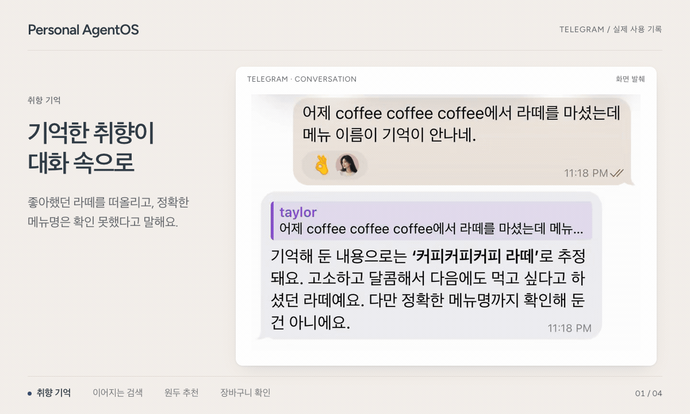
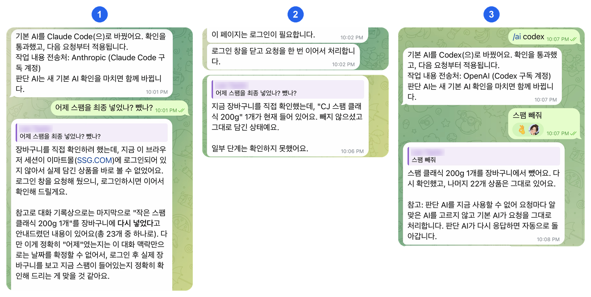
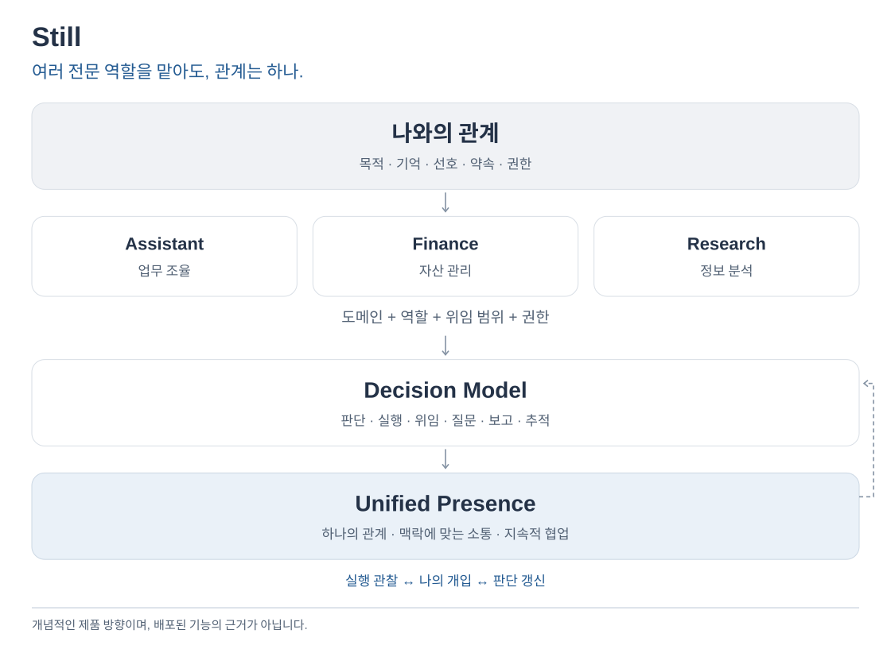
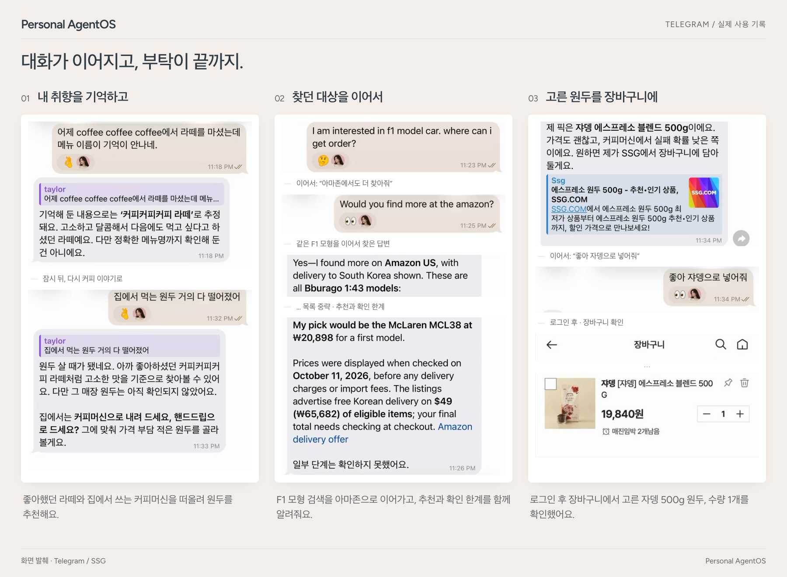

<div align="center">

<pre>
   ________________   __ 
  / __/_  __/  _/ /  / / 
 _\ \  / / _/ // /__/ /__
/___/ /_/ /___/____/____/
</pre>

**AI를 바꿔도, 나의 비서는 그대로.**

내 컴퓨터에 설치하는 오픈소스 개인 비서.

[](https://github.com/Jongtae/Still/releases) [](https://github.com/Jongtae/Still/actions/workflows/validate.yml) [](../../docs/QUICKSTART.md) [](../../LICENSE)

[English](../../README.md) | [한국어](README.ko.md) | [简体中文](README.zh-CN.md) | [日本語](README.ja.md)

[직접 써보기](#빠른-시작) · [지금 할 수 있는 것](#지금-할-수-있는-것) · [내 정보와 권한](#나에게-남는-것) · [피드백 보내기](#문서) · [Engineering](https://jongtae.github.io/Still/engineering/ko.html)

</div>

<!-- readme-parity:v1 -->

<!-- readme-section:hero -->

## AI를 바꿀 때마다, 나를 다시 설명해야 할까요?

내 취향, 어제 나눈 이야기, 아직 끝내지 못한 일. 더 좋은 AI를 쓰고 싶다는 이유로 이 모든 것을 처음부터 다시 시작할 필요는 없지 않을까요?

**Still은 나에 대한 기억과 진행 중인 일, 맡긴 권한을 일하는 AI와 분리해 내 컴퓨터에 남깁니다.** Codex, Claude Code, 모델 API, Ollama를 연결해 사용할 수 있습니다. 일하는 AI가 바뀌어도, 비서가 이어갈 맥락은 나에게 남습니다.

<p align="center">
  
</p>
<p align="center"><sub>실제 Telegram·브라우저 녹화를 편집했습니다. <a href="../../docs/assets/readme/demo/README.md">녹화 기록</a>.</sub></p>

<!-- readme-section:ai-switch -->

## AI를 바꿔도 이어지는 대화

아래 기록에서는 Claude Code로 바꾼 뒤 어제의 쇼핑 대화를 묻습니다. 이어서 Codex로 바꾼 뒤에는 “스팸 빼 줘.”라고 말합니다. Still은 처음부터 설명해 달라고 하는 대신, 같은 대화의 맥락을 이어갑니다.

<details>
<summary>실제로 AI를 바꿔가며 나눈 대화 보기</summary>

<p align="center">
  
</p>

로그인 링크는 잘라내고 이름은 가렸습니다. [크게 보기](../../docs/assets/readme/ai-switch/ai-switch-conversation.png) · [녹화 근거](../../docs/assets/readme/ai-switch/manifest.json).

</details>

*한국어로 진행한 실제 사용자 세션을 편집한 기록입니다. 대화의 연속성을 보여 주며, 장바구니 변경의 독립 검증이나 모든 배포본에서의 재현성을 입증하는 자료는 아닙니다.*

<!-- readme-section:try-today -->

## 빠른 시작

**macOS, Linux 또는 [WSL2](../../docs/QUICKSTART.md#windows-wsl2)를 사용하는 Windows**와 AI 연결 하나가 필요합니다. Codex, Claude Code, API 또는 이미 실행 중인 Ollama를 사용할 수 있습니다. 구독 방식은 해당 CLI를 이용할 수 있는 플랜과 로그인이 필요하며, AI 구독·API 사용·모델 다운로드는 Still과 별도입니다. [AI 연결 안내](../../docs/QUICKSTART.md#connect-an-ai)를 참고하세요.

먼저 [고정된 버전의 설치 스크립트](https://github.com/Jongtae/Still/blob/17fe561e271f033e660e13edd2c272acfcee2347/scripts/install.sh)를 확인한 뒤, macOS·Linux 터미널 또는 WSL2의 Ubuntu에서 실행하세요.

```sh
curl -LsSf https://raw.githubusercontent.com/Jongtae/Still/17fe561e271f033e660e13edd2c272acfcee2347/scripts/install.sh | sh
```

Python, Homebrew, Docker를 미리 설치할 필요는 없습니다. 설치 스크립트가 Python 환경을 준비하고, 배포 아카이브의 SHA-256을 기록된 값과 대조합니다.

터미널 설정에서 사용할 AI를 고르세요. 그 자리에서 대화하거나 같은 컴퓨터의 [http://127.0.0.1:8787/](http://127.0.0.1:8787/)을 열면 됩니다. **처음부터 메일, 캘린더, 메신저를 모두 연결할 필요는 없습니다.**

### 작은 대화 하나부터 시작하세요

민감한 정보가 없는 짧은 글을 붙여 넣고 **“이 내용을 세 문장으로 요약해 줘.”**라고 해 보세요. 이어서 **“중요한 날짜는 남기고 더 짧게 해 줘.”**라고 요청하세요. 처음 시도할 요청의 예시이지, 실제 검증 결과를 인용한 대화는 아닙니다. 답이 맞는지, 후속 요청에서 앞선 맥락을 활용하는지 확인한 다음, 실제로 도움받고 싶은 낮은 위험의 일을 맡겨 보세요.

Telegram을 쓰려면 “텔레그램 연결해줘”라고 말하고 페어링 안내를 따르세요. 봇 토큰은 전용 숨김 입력 칸에만 넣고, 일반 대화 메시지로 보내지 마세요.

원격 요청과 예약 작업을 처리하려면 `agentos start`를 실행한 상태로 두고 컴퓨터가 잠들지 않게 해야 합니다. macOS에서는 `agentos service install`로 로그인 시 실행되는 백그라운드 서비스를 등록할 수 있습니다. 설치만으로 서비스가 등록되지는 않습니다. [실행·재시작 안내](../../docs/guide/operations.en.md#background-service-macos).

<details>
<summary>Apple Silicon Mac에서 Homebrew로 설치하기</summary>

```sh
brew tap jongtae/still https://github.com/Jongtae/Still
brew install jongtae/still/agentos
agentos start
```

Intel Mac에서는 위의 한 줄 설치 명령을 쓰세요. 호환성을 위해 명령 이름은 아직 `agentos`이며, 이 명령으로 Still을 실행합니다.

</details>

**배포 상태:** 두 설치 방법 모두 태그가 붙은 main 커밋으로 빌드한 **v0.6.0**(2026-11-07)을 설치합니다. 데모와 일상 사용 화면은 실제 사용 세션에서 가져온 것으로, 이 배포본을 처음부터 끝까지 검증한 결과는 아닙니다. 구조 그림은 제품 방향을 보여 주는 예시입니다. 정확한 배포 범위와 검증의 한계는 [release manifest](../../docs/release-manifest.json)를 참고하세요.

설정, Windows 제약, 업데이트와 제거 방법: [QUICKSTART](../../docs/QUICKSTART.md).

<!-- readme-section:capabilities -->

## 지금 할 수 있는 것

| 하고 싶은 일 | Still이 제공하는 것 |
| --- | --- |
| 같은 설명을 반복하지 않고 이어가기 | 저장된 기억과 이전 맥락을 이후 요청에 활용합니다. 기억한 내용을 확인하고 수정할 수 있습니다. |
| 다른 AI로 바꾸기 | `/ai`로 연결된 AI를 바꾸되, Still의 기억과 작업 기록은 유지합니다. |
| 내 자료로 일하기 | 연결한 폴더, Google Drive, Gmail 검색과 별도로 허용한 메일함 정리, Google Calendar를 사용합니다. Gmail 발송은 지원하지 않습니다. |
| 웹사이트에서 도움받기 | 내가 로그인한 사이트에서 브라우저 도구를 사용합니다. 호환성과 로그인 요구는 사이트·플랫폼마다 다릅니다. |
| 일하는 도중 요청 바꾸기 | 작업 중에 별개의 질문을 하거나 진행 중인 요청을 바로잡을 수 있습니다. |
| 편한 곳에서 대화하기 | 터미널, 브라우저, Telegram, Slack·Mattermost 다이렉트 메시지를 지원합니다. |

Still은 계속 개발 중입니다. 작은 일부터 시작하고, 필요할 때 연결을 추가하세요. 모델, 권한, 서비스 설정과 웹사이트 동작에 따라 결과가 달라지므로, 모든 모델과 사이트에서 모든 작업이 된다는 약속은 아닙니다. [현재 상태](../../docs/product-status.ko.md)는 구현·실사용 기록·제품 방향을 구분하며, 정확한 배포 포함 범위는 위의 release manifest에서 확인할 수 있습니다.

<!-- readme-section:ownership -->

## 나에게 남는 것

실제로 일하는 것은 AI입니다. Still은 그 AI가 바뀌어도 사라지지 않아야 할 것을 보관합니다. **나에 대한 기억과 맥락, 끝나지 않은 일, 권한과 승인, 실제 실행 기록**입니다. 이 상태가 남는다는 것이 모델마다 답변이나 도구 지원이 똑같다는 뜻은 아닙니다.

**로컬 우선(local-first)이 로컬 전용(local-only)을 뜻하지는 않습니다.** 외부 AI를 쓰면 요청에 필요한 대화와 맥락은 해당 제공자에게 전송됩니다. 원격 서비스를 연결해도 그 서비스의 데이터 보관까지 Still이 통제하지는 않습니다. 민감하지 않은 자료로 시작하고, 사용할 폴더와 계정만 연결하세요.

### 권한과 결제

연결한 폴더는 쓰기를 허용하지 않으면 읽기 전용입니다. 행동에 따라 권한 규칙이 다르므로, 서비스를 연결한 뒤 모든 변경마다 다시 확인을 받는 구조는 아닙니다. Still은 일마다 어떤 정보를 사용했는지 기록합니다. 비밀번호와 토큰은 대화가 아닌 전용 입력 칸에 넣으세요. [보안과 비밀값 처리](../../.github/SECURITY.md)를 참고하세요.

**기본적으로 결제마다 승인을 받으며, 자율 결제 모드는 꺼져 있습니다.** 직접 이 모드를 켜면 예약 작업을 포함해 AI가 매번 묻지 않고 결제와 자금 이동을 실행할 수 있습니다. 켜져 있는 동안에는 현재 **금액·기간·연결별 한도가 없습니다.** 처음 써볼 때는 꺼 두세요. 이 기능이 배포에 포함됐다는 사실은 실제 결제나 증권 주문 흐름을 검증했다는 뜻이 아닙니다. 사용 전에 [release manifest](../../docs/release-manifest.json)를 확인하세요.

<!-- readme-section:presence -->

## 동작 방식

Still은 비서가 유지할 상태와 요청을 실행하는 AI를 분리합니다. 목표는 일하는 AI나 도구가 바뀔 때마다 새 비서를 만나는 것이 아니라, 하나의 대화를 계속 이어가는 것입니다.

내부 구조를 알아야 사용해 볼 수 있는 것은 아닙니다. 설계와 구현, 검증 근거가 궁금하다면 [Engineering](https://jongtae.github.io/Still/engineering/ko.html)에서 각각을 구분해 볼 수 있습니다.

<details>
<summary>아키텍처와 제품 방향 살펴보기</summary>

<picture>
  <source media="(max-width: 600px)" srcset="../../docs/assets/readme/presence-overview.ko.narrow.svg">
  
</picture>

이 그림은 설계 방향입니다. 실제 실행 기록이 아니며, 그림의 모든 역할이 전문 에이전트로 배포됐다는 뜻도 아닙니다. [아키텍처](../../docs/personal-agentos-architecture.en.md) · [Presence](../../docs/presence-experience-contract.en.md) · [왜 만드는가](../../docs/VISION.md).

</details>

<!-- readme-section:conversation -->

## 일상에서 쓰는 모습

*실제 Telegram 대화(한국어 화면)에서 발췌하고 짧은 장면 설명을 붙였습니다.*

커피 취향을 다음 추천에 활용하고, F1 모형 검색을 아마존에서 이어가며, 로그인 뒤 선택한 원두의 장바구니 상태를 답하는 장면입니다. 장바구니에 대한 답변은 계정 상태를 독립적으로 검증한 기록이 아니며, 담기와 결제는 서로 다른 행동입니다.

<details>
<summary>실제 대화 장면 더 보기</summary>

<picture>
  <source media="(max-width: 600px)" srcset="../../docs/assets/readme/readme-examples-v4.ko.png">
  
</picture>

</details>

<!-- readme-section:engineering -->

## Engineering

이 연속성이 어떻게 만들어지는지 궁금하다면 [Engineering](https://jongtae.github.io/Still/engineering/ko.html)과 [Research & Evidence](https://jongtae.github.io/Still/engineering/ko.html#research)부터 살펴보세요. 기억, 판단, 실행과 소유자 통제를 다루며 코드와 실험으로 연결됩니다. 설계, 자동화 테스트, 실제 사용 관찰은 서로 다른 종류의 근거입니다.

<!-- readme-section:more -->

## 문서

[QUICKSTART](../../docs/QUICKSTART.md) · [현재 상태](../../docs/product-status.ko.md) · [문서 지도](../../docs/README.md) · [기여 안내](../../.github/CONTRIBUTING.md) · [기여자 시작 안내](../../docs/contributor-onboarding.en.md) · [참고와 감사](../../docs/acknowledgements.en.md)

### 당신의 일 하나를 맡겨 보고 알려주세요

Still이 궁금한 것은 멋진 데모 하나가 아니라, 실제로 다시 쓸 만한지입니다. 부담이 작은 일 하나를 맡겨 보고 알려주세요. **어디서 막혔나요? 무엇을 두 번 설명해야 했나요? 내일도 다시 맡기고 싶은 일은 무엇인가요?**

[피드백 양식](https://github.com/Jongtae/Still/issues/new?template=feedback.yml)이나 [Discussions](https://github.com/Jongtae/Still/discussions)를 이용하세요. 운영체제, Still 버전, AI 연결 방식과 개인정보를 가린 예시가 도움이 됩니다. 인증 정보, 개인 문서, 로그인 링크는 공개하지 마세요. 보안 문제는 공개 이슈 대신 [SECURITY.md](../../.github/SECURITY.md)에 안내된 경로로 알려주세요.

<!-- readme-section:license -->

## 라이선스

[AGPL-3.0-only](../../LICENSE). Still의 이름과 로고에는 [TRADEMARKS.md](../../docs/TRADEMARKS.md)가 적용됩니다.
