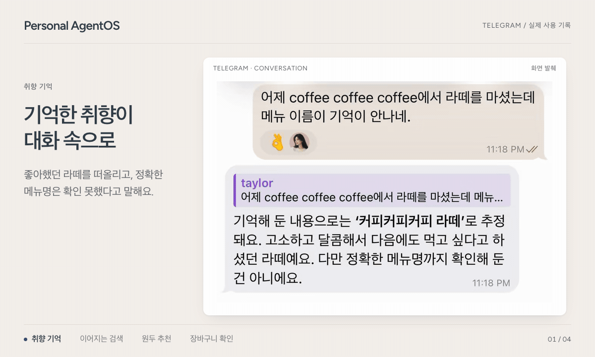
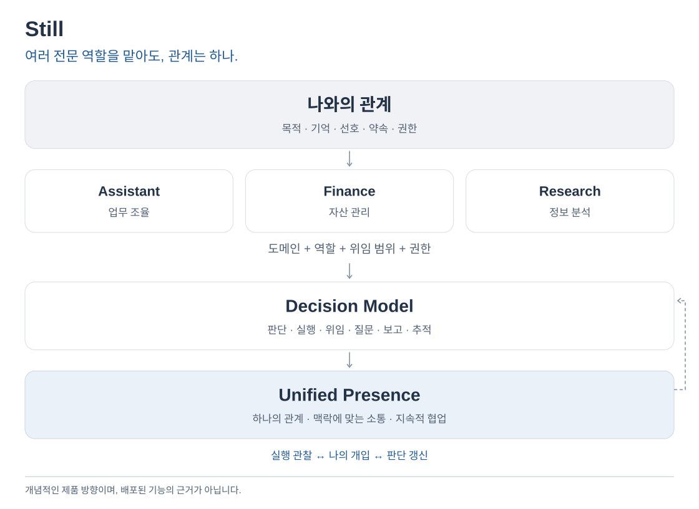
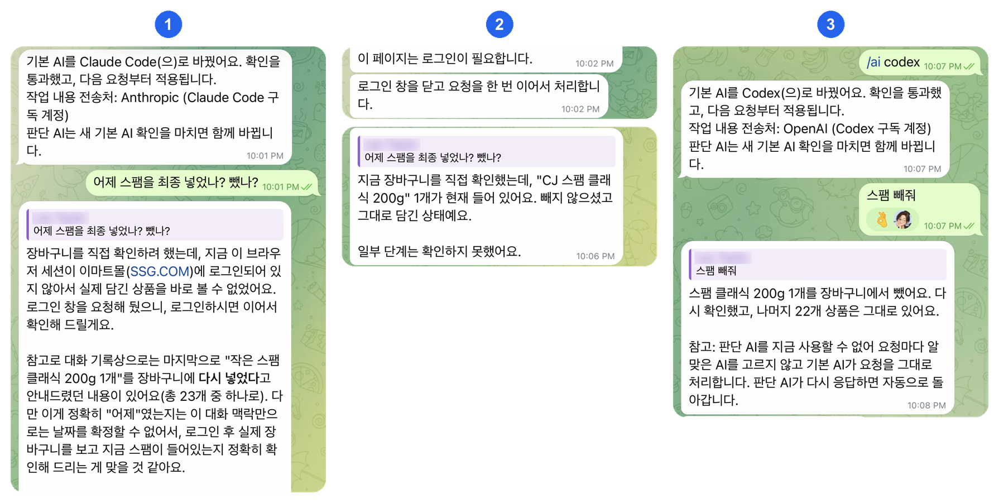
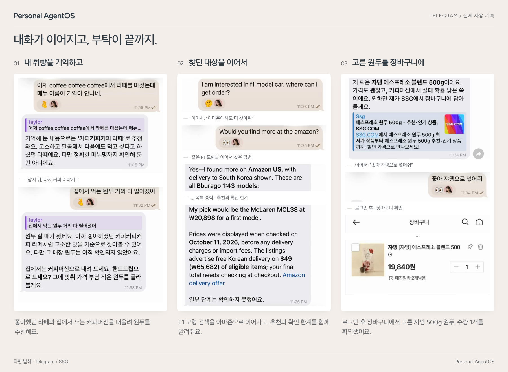

<div align="center">

<pre>
          P E R S O N A L           
                                    
   ___                __  ____  ____
  / _ |___ ____ ___  / /_/ __ \/ __/
 / __ / _ `/ -_) _ \/ __/ /_/ /\ \  
/_/ |_\_, /\__/_//_/\__/\____/___/  
     /___/                          
</pre>

**내 컴퓨터에서 돌아가는 나만의 개인 에이전트.<br>일하는 AI를 바꿔도 기억과 진행 중인 일, 권한은 그대로 남습니다.**

[](https://github.com/Jongtae/agentos/actions/workflows/validate.yml) [](https://github.com/Jongtae/agentos/actions/workflows/full-validate.yml) [](https://github.com/Jongtae/agentos/releases) [](../../pyproject.toml) [](../../docs/QUICKSTART.md) [](../../LICENSE)

[English](../../README.md) | [한국어](README.ko.md) | [简体中文](README.zh-CN.md) | [日本語](README.ja.md)

[빠른 시작](#빠른-시작) · [나에게 남는 것](#나에게-남는-것) · [동작 방식](#동작-방식) · [문서](#문서)

</div>

<!-- readme-parity:v1 -->
<!-- readme-section:hero -->

## 자비스의 두뇌가 내 것이 아니어도, 나만의 자비스를 가질 수 있을까?

**두뇌는 빌려 쓰더라도, 비서는 내 것이어야 합니다.**

토니 스타크에게는 자비스(J.A.R.V.I.S.)가 있었습니다. 토니의 사정을 잘 알고, 언제든 말을 걸 수 있으며, 컴퓨터와 여러 시스템을 움직여 실제로 일을 해내는 개인 AI 비서였습니다. 토니는 그 두뇌가 되는 기술까지 직접 가지고 있었습니다. 하지만 우리 대부분은 가장 뛰어난 AI 두뇌를 소유하지 못합니다. 외부 기업의 모델을 빌려 쓰고, 그 성능과 가격, 정책, 이용 조건은 언제든 바뀔 수 있습니다.

그래서 질문은 *우리도 자비스를 만들 수 있을까?*에서 끝나지 않습니다. **두뇌는 빌려 쓰더라도 내 기억과 맥락, 끝내지 못한 일, 맡겨 둔 권한을 지켜 주는 진짜 내 비서를 가질 수 있을까?** 더 좋은 AI가 나올 때마다 그동안 쌓아 온 관계를 버려야 할까요?

Still은 *그럴 필요가 없다*는 답을 찾아갑니다. 내가 설치하고 관리하는 오픈소스 환경에서 하나의 개인 에이전트(PA)가 내 맥락과 진행 중인 일, 권한을 지키고, 실제로 일하는 AI는 얼마든지 바꿀 수 있게 합니다.

<p align="center">
  
</p>
<p align="center"><sub>실제 녹화 화면을 편집했습니다.</sub></p>

**주요 기능**

- **이미 구독 중인 AI를 그대로.** ChatGPT 구독은 Codex로, Claude 구독은 Claude Code로 연결해 실제 일을 맡깁니다. 그 밖의 연결 방법은 [QUICKSTART](../../docs/QUICKSTART.md#other-model-connections)에 있습니다.
- **대화가 바뀌어도 같은 PA.** 기억과 저장한 결과, 진행 중인 일의 상태는 새 대화를 시작하거나 다시 켠 뒤에도 남습니다. 실행이 중간에 끊기면 몰래 다시 돌리지 않고 끊겼다고 알립니다.
- **경계는 내가 정합니다.** 접근은 내가 연결한 폴더·계정·도구에서 시작합니다. 지원되는 결제 흐름은 결제할 때마다 승인을 받으며, [현재 브라우저의 한계](https://github.com/Jongtae/agentos/issues/758)도 공개합니다. [비밀값](../../.github/SECURITY.md)은 모델 프롬프트·로그·Evidence에 들어가지 않습니다.
- **숨기지 않고 알립니다.** AI가 무언가를 기억하면 그 사실을 알리고, 기억한 내용만 정확히 되돌릴 수 있게 합니다. 맡긴 일마다 내 정보 중 무엇을 썼고 어디로 보냈는지 기록합니다.
- **늘 쓰는 곳에서 대화.** 휴대폰의 Telegram이나 macOS·Linux 브라우저에서 이야기하면 됩니다. Windows에서는 [WSL2](../../docs/QUICKSTART.md#windows-wsl2)로 동작하며, 아직 제약이 있습니다.

<!-- readme-section:principles -->

## Still의 다섯 가지 핵심 원칙

이 다섯 가지는 특정 AI 모델의 기능이 아닙니다. 우리가 만드는 비서가 무엇을 갖춰야 하는지 가늠하는 기준입니다.

- **Presence:** 일을 시키려고 앱을 따로 찾아갈 필요 없이, 평소 소통하는 곳에서 늘 함께하는 비서.
- **Portable Memory:** 내 기억과 맥락이 특정 AI 서비스에 묶이지 않는 것.
- **Model Independence:** AI 모델을 바꿔도 비서와 쌓아 온 관계가 끊기지 않는 것.
- **Execution:** 대답에 그치지 않고 실제 서비스와 컴퓨터에서 일을 해내는 능력.
- **Owner Control:** 내 데이터와 권한, 실행 결과를 내가 통제하는 것.

모든 장면이 이미 동작한다는 뜻은 아닙니다. 실제로 확인된 것과 아직 다듬는 중인 것은 [현재 상태](../../docs/product-status.ko.md), 위의 실제 데모, [브라우저의 알려진 한계](https://github.com/Jongtae/agentos/issues/758)에서 구분해 보여 줍니다.

<!-- readme-section:try-today -->

## 빠른 시작

**시작하기 전에 준비할 것:**

- Mac, Linux 컴퓨터 또는 WSL2가 설치된 Windows, 그리고 인터넷 연결.
- 일을 맡길 AI 하나: ChatGPT 구독과 [Codex CLI](https://github.com/openai/codex), Claude 구독과 [Claude Code](https://code.claude.com/docs/en/setup), 또는 API 키(OpenAI, Anthropic, OpenAI 호환 서버)나 이 컴퓨터의 [Ollama](https://ollama.com). CLI가 아직 없으면 첫 설정에서 설치 페이지를 열어 줍니다.
- 선택: 휴대폰이나 컴퓨터의 [Telegram](https://telegram.org). @BotFather로 만든 봇을 통해 휴대폰에서 Still과 대화합니다.

macOS, Linux, Windows(WSL2)에서 명령 하나로 설치하고 바로 시작합니다. Homebrew, Python, Docker는 필요 없습니다.

```sh
curl -LsSf https://raw.githubusercontent.com/Jongtae/Still/main/scripts/install.sh | sh
```

실행 전에 [스크립트를 직접 확인](https://github.com/Jongtae/Still/blob/main/scripts/install.sh)할 수 있으며, 스크립트는 내려받는 Still 공개 아카이브와 uv 설치 프로그램의 체크섬을 검증합니다. 배포할 때마다 이 URL은 그 배포본을 설치하는 커밋으로 고정됩니다.

Windows에서는 PowerShell에서 `wsl --install`을 실행하고 재시작한 뒤, Ubuntu를 열어 첫 번째 명령을 실행하세요. Windows 안내, 설치 스크립트가 하는 일, 소스 실행, 모든 설정은 [QUICKSTART](../../docs/QUICKSTART.md)에 있습니다. 대화하는 동안에는 `agentos start`를 계속 실행해 두세요.

macOS에서 [Homebrew](https://brew.sh)를 쓴다면:

```sh
brew tap jongtae/still https://github.com/Jongtae/Still
brew install jongtae/still/agentos
agentos start
```

1. 처음 실행하면 이 터미널에서 설정합니다. Claude Code를 처음 켰을 때와 같은 방식입니다. 접근 비밀번호(선택), AI 연결(Codex로 ChatGPT, Claude Code로 Claude, 또는 API 키), Telegram 봇 토큰(선택)을 차례로 묻습니다. 각 단계는 Enter로 건너뛸 수 있습니다.
2. 그다음 브라우저에서 [http://127.0.0.1:8787](http://127.0.0.1:8787/)이 열리며 마지막 확인을 합니다. 화면은 기본이 영어이며, 왼쪽 아래에서 한국어, 중국어 간체, 일본어로 바꿀 수 있습니다. Telegram의 일부 고정 상태·진행 문구와 일부 연결 검증 오류는 아직 언어 설정과 관계없이 한국어로 나옵니다. [그 밖의 연결 방법](../../docs/QUICKSTART.md#other-model-connections)
3. Telegram 페어링: 터미널에서 BotFather 토큰을 붙여 넣으면 페어링 링크가 출력됩니다. 링크를 열고 Start를 누르세요.
4. 필요한 것을 말해 보세요. **“고양이가 요즘 사료를 잘 안 먹어. 어떻게 하면 좋을까?”** 며칠 뒤 **“50만 원 이하 로봇청소기 하나 골라 줘.”**라고만 해도, PA가 고양이 이야기를 알아서 기억하고 반영합니다.

**배포 상태:** 아직 공개된 Still 배포본이 없어서, 첫 배포 전까지 두 설치 방법 모두 아무것도 설치하지 않고 멈춥니다. 데모와 일상 사용 화면은 실제 사용 세션에서 가져온 것이고, 구조 그림은 제품 방향을 보여 주는 예시입니다. 배포본별 포함 범위는 [release manifest](../../docs/release-manifest.json)에, 제공 기능·테스트 근거·방향의 구분은 [현재 상태](../../docs/product-status.ko.md)에 정리되어 있습니다.

**제거:** `agentos uninstall`은 백그라운드 서비스와 프로그램을 지우고, 데이터는 지우겠다고 고르지 않는 한 남깁니다([자세히](../../docs/QUICKSTART.md#uninstall)).

<!-- readme-section:ownership -->

## 나에게 남는 것

| 바뀔 수 있는 것 | 나에게 남는 것 |
| --- | --- |
| 모델과 제공자 | 나에 대한 기억과 맥락 |
| 일을 맡은 CLI 에이전트나 API | 진행 중인 일과 다음 단계 |
| 도구와 커넥터 | 권한과 승인 |
| | 실제로 실행된 일의 기록 |

더 좋은 AI가 나오면 에이전트는 그대로 두고 일하는 AI만 바꾸면 됩니다. 이 질문은 [누구의 에이전트인가?](../../docs/whitepapers/whose-agent.ko.md) 백서에서 더 깊이 다룹니다.

로컬 우선(local-first)이 로컬 전용(local-only)을 뜻하지는 않습니다. 구독 AI는 OpenAI나 Anthropic의 서버에서 동작하므로, 요청에 쓰이는 맥락은 해당 제공자에게 전송됩니다.

<!-- readme-section:presence -->

## 동작 방식

<picture>
  <source media="(max-width: 600px)" srcset="../../docs/assets/readme/presence-overview.ko.narrow.svg">
  
</picture>

- **나와의 관계**는 목적·기억·선호·약속·권한을 내가 통제하는 곳에 둡니다.
- **전문 관점**은 같은 상황을 해당 도메인과 역할의 눈으로 읽습니다. 위임 범위는 목표와 한계를 정하고, 실제 권한은 그와 별도로 지켜집니다.
- **Decision Model**은 생각할지, 실행할지, 맡길지, 물을지, 알릴지, 이어서 챙길지를 판단합니다. 도구를 고르는 데서 그치지 않습니다.
- **Unified Presence**는 역할이 아닙니다. 모든 역할에 걸쳐 하나의 관계를 유지해, 의미 있는 소식은 나에게 전하고 내가 바로잡은 내용은 진행 중인 일에 반영합니다(실행 환경이 지원하는 범위 안에서).

역할은 자격이나 실행 권한이 아닙니다. 여러 역할이 함께 일하는 모습도 아직 배포된 기능이 아닌 제품 방향입니다([계약](../../docs/professional-roles-and-communication-contract.en.md)). 그림은 설계 방향을 나타낼 뿐, 실제 실행을 관찰한 것이 아닙니다. 자세히 보기: [아키텍처와 온톨로지](../../docs/personal-agentos-architecture.en.md) · [Presence](../../docs/presence-experience-contract.en.md)

<!-- readme-section:ai-switch -->

## AI를 바꿔도 이어지는 대화

<p align="center">
  
</p>
<p align="center"><sub>실제 대화에서 발췌한 화면입니다. 로그인 링크는 잘라내고 이름은 가렸습니다. · <a href="../../docs/assets/readme/ai-switch/ai-switch-conversation.png">크게 보기</a></sub></p>

① **Claude Code로 전환.** “어제 스팸을 넣었나, 뺐나?”라고 묻자 PA가 이전 쇼핑 대화를 이어받습니다.

② **현재 장바구니 확인.** 다시 로그인하자 스팸 클래식 200g 한 개가 장바구니에 있다고 답합니다.

③ **Codex로 전환해 다음 일 요청.** “스팸 빼 줘.”라고 하자 같은 대화 안에서 뺀 결과와 남은 22개 상품을 알려 줍니다.

<!-- readme-section:conversation -->

## 일상에서 쓰는 모습

*실제 Telegram 대화(한국어 화면)에서 발췌하고 짧은 장면 설명을 붙였습니다.*

<picture>
  <source media="(max-width: 600px)" srcset="../../docs/assets/readme/readme-examples-v4.ko.png">
  
</picture>

전에 말한 라테 취향은 커피머신용 원두를 고를 때 다시 기준이 됩니다. F1 모형 검색은 다시 설명하지 않아도 아마존으로 이어지고, 추천과 함께 확인하지 못한 부분도 알려 줍니다. 원두를 고르면 로그인된 장바구니에 1개가 담긴 것까지 확인합니다. **내가 말하거나 보여 준 것 → 출처와 시각이 있는 허락된 맥락 → 필요한 질문이나 도구 → 행동의 경계 → 확인된 결과.** 장바구니에 담는 것과 결제하는 것은 별개의 행동입니다.

**다음 목표:** 몇 시간이 지나도 “그거”, “같은 걸로”가 무엇을 가리키는지 알아듣는 것. 워크플로를 짜 맞추지 않고 대화만 이어 가면 됩니다.

> “커피가 거의 떨어졌네.” · *몇 시간 뒤* · “나가는 길에 살 데 있어?” · *그 뒤* · “시간 없다. 지난번이랑 같은 걸로.”

<!-- readme-section:more -->

## 문서

| 문서 | 내용 |
| --- | --- |
| [QUICKSTART](../../docs/QUICKSTART.md) | 설치, 모델 연결, 파일, Telegram, 소스 실행 |
| [현재 상태](../../docs/product-status.ko.md) | 되는 것, 아직 불편한 것, 영역별 근거 |
| [왜 만드는가](../../docs/VISION.md) | 프로젝트의 동기 |
| [아키텍처와 온톨로지](../../docs/personal-agentos-architecture.en.md) | 커널 기본 개념, 패키지, 런타임, 소유자 통제 |
| [문서 지도](../../docs/README.md) | 현재 계약과 가이드 전체 |
| [참고한 연구와 프로젝트](../../docs/acknowledgements.en.md) | 설계에 영향을 준 연구와 프로젝트 |

**기여하기.** 이슈와 PR을 환영합니다. [CONTRIBUTING](../../.github/CONTRIBUTING.md)부터 읽어 주세요. 개발 흐름은 [AGENTS.md](../../AGENTS.md)에 있습니다. 코드를 처음 보신다면 [기여자 온보딩 안내](../contributor-onboarding.en.md)(영문)에서 코드 구조와 첫 작업 방법을 먼저 확인해 보세요. 써 보셨다면 [피드백 양식](https://github.com/Jongtae/agentos/issues/new?template=feedback.yml)이나 [Discussions](https://github.com/Jongtae/agentos/discussions)에 좋았던 점과 아쉬운 점을 남겨 주세요.

<!-- readme-section:license -->

## 라이선스

[AGPL-3.0-only](../../LICENSE). Still 이름과 로고는 [상표 안내](../../docs/TRADEMARKS.md)를 따릅니다.
