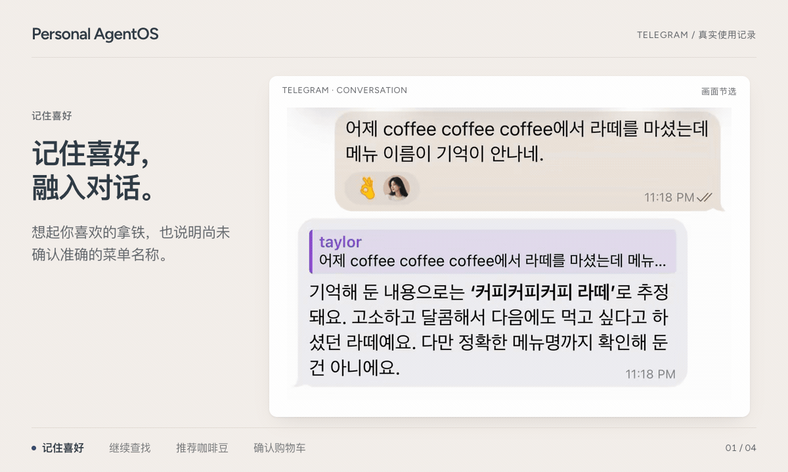
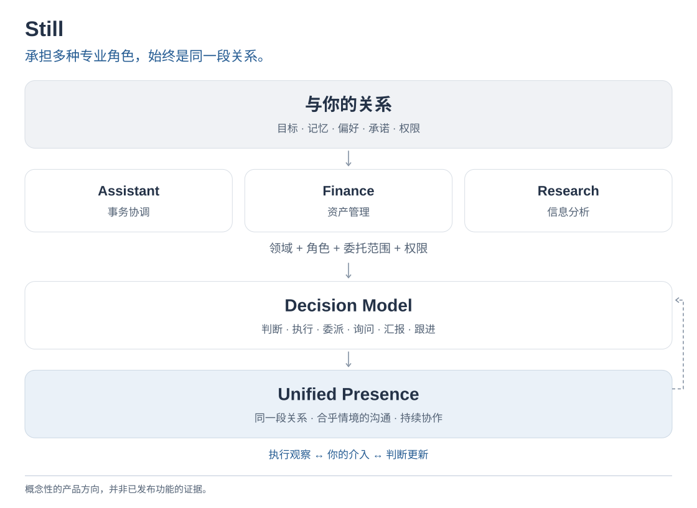
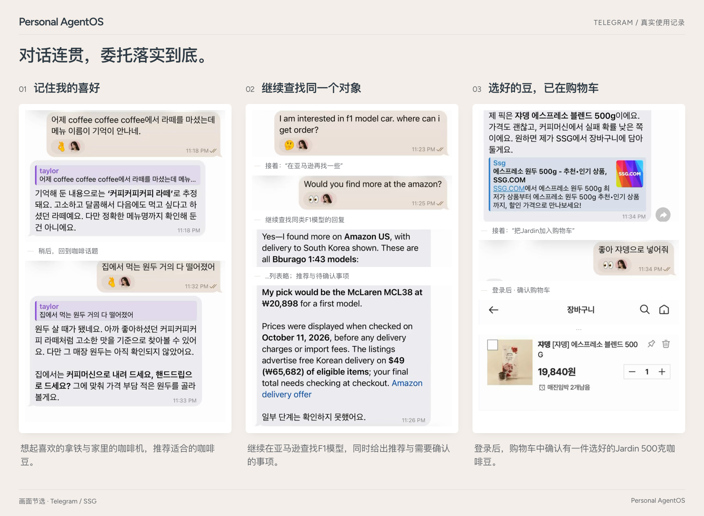

<div align="center">

<pre>
   ________________   __ 
  / __/_  __/  _/ /  / / 
 _\ \  / / _/ // /__/ /__
/___/ /_/ /___/____/____/
</pre>

**在你自己电脑上运行的个人智能体。<br>底层 AI 可以更换，记忆、进行中的工作和权限都会保留。**

[](https://github.com/Jongtae/Still/actions/workflows/validate.yml) [](https://github.com/Jongtae/Still/actions/workflows/full-validate.yml) [](https://github.com/Jongtae/Still/releases) [](../../pyproject.toml) [](../../docs/QUICKSTART.md) [](../../LICENSE)

[English](../../README.md) | [한국어](README.ko.md) | [简体中文](README.zh-CN.md) | [日本語](README.ja.md)

[目前能做什么](#目前能做什么) · [快速开始](#快速开始) · [留给你的东西](#留给你的东西) · [文档](#文档)

</div>

<!-- readme-parity:v1 -->

<!-- readme-section:hero -->

## 借来的大脑，属于你自己的 J.A.R.V.I.S.

我们大多数人并不拥有自己使用的 AI 模型；模型的提供方随时可能改变价格、规则和可用性。Still 是一个安装在你自己电脑上的开源助手。它把关于你的了解、尚未完成的工作和你交付的权限都保存在那里，而真正干活的 AI，也就是你已经订阅的那个，可以更换。

<p align="center">
  
</p>
<p align="center"><sub>由真实录屏剪辑而成。</sub></p>

<!-- readme-section:capabilities -->

## 目前能做什么

- **用你已经付费的 AI。** ChatGPT 订阅通过 Codex、Claude 订阅通过 Claude Code 完成实际工作；也可以用 API 密钥或 [Ollama](https://ollama.com)。在对话中用 `/ai` 切换，对话会照常继续。
- **在你所在的地方对话。** 终端和浏览器、Telegram，以及 Slack 或 Mattermost 的私信。
- **不用提醒也记得。** 你上周说过的事，会在需要时再次用上。它每天回顾一次最近的请求来整理记忆，每条事实都会标明依据是你本人的话还是推断。每次保存都可以撤销。
- **处理你的东西。** 你连接的文件夹（除非你另行允许，否则只读）、Gmail 搜索以及在你允许时整理邮箱（从不发送邮件）、Google 日历和云端硬盘，以及你登录过的网站，即使在手机上也可以。
- **不让你干等。** 长任务开始前，它会告诉你计划和由哪个 AI 负责。运行期间你可以问别的事，也可以中途纠正它。
- **该停的地方会停。** 每笔付款都需要你同意。[密钥](../../.github/SECURITY.md)不会进入提示词或日志。每项任务都会列出用了你的哪些信息、发送到了哪里。

其中一些功能仍不够完善；[产品状态](../../docs/product-status.en.md)说明了是哪些。

<!-- readme-section:try-today -->

## 快速开始

你需要一台 Mac、Linux 电脑或装有 [WSL2](../../docs/QUICKSTART.md#windows-wsl2) 的 Windows（有一些限制），以及一个 AI：ChatGPT 订阅加 [Codex CLI](https://github.com/openai/codex)、Claude 订阅加 [Claude Code](https://code.claude.com/docs/en/setup)、API 密钥或 Ollama。一条命令即可安装并启动 Still，无需 Homebrew、Python 或 Docker：

```sh
curl -LsSf https://raw.githubusercontent.com/Jongtae/Still/ebf97d4150be3eb867649a31e79287f05db02886/scripts/install.sh | sh
```

运行前可以先[检查脚本](https://github.com/Jongtae/Still/blob/ebf97d4150be3eb867649a31e79287f05db02886/scripts/install.sh)；它会校验所下载的每一个文件。在 Windows 上，请在 PowerShell 中运行 `wsl --install` 并重启，然后在 Ubuntu 中运行这条命令。如果你在 Apple 芯片的 Mac 上使用 [Homebrew](https://brew.sh)，也可以这样安装（Homebrew 已不再为 Intel Mac 构建软件包，Intel Mac 请使用上面的命令）：

```sh
brew tap jongtae/still https://github.com/Jongtae/Still
brew install jongtae/still/agentos
agentos start
```

1. 设置在终端中进行：先是可选的访问密码，然后选择你的 AI（已登录的 AI 会预先选中）。可以直接在终端里和 Still 对话，也可以在 [http://127.0.0.1:8787](http://127.0.0.1:8787/) 的 Still 界面中对话。对话期间请保持 `agentos start` 运行。在 Mac 上运行一次 `agentos service install`，Still 就会在没有终端的情况下在后台持续运行，并在每次登录时重新启动（[详情](../../docs/QUICKSTART.md#background-service-macos)）。
2. 使用 Telegram 时，说“帮我连接 Telegram”，把 @BotFather 的令牌粘贴到隐藏输入框中，然后打开配对链接并点击 Start。
3. 问你真正需要的事：**“我家猫最近不怎么吃饭，该怎么办？”** 几天后再说 **“帮我挑一台 3000 元以内的扫地机器人。”** 它会记得你的猫。

所有设置、Windows 说明以及卸载方法（除非你另行选择，`agentos uninstall` 会保留你的数据）请见 [QUICKSTART](../../docs/QUICKSTART.md)。

**发布状态：** 两种安装方式安装的都是从已打标签的 main 提交构建的 **v0.3.0**（2026-10-31）。演示和日常使用画面来自真实使用会话，并非该发行版本的端到端验证；架构图属于产品方向。[release manifest](../../docs/release-manifest.json) 记录每个版本的覆盖范围，[产品状态](../../docs/product-status.en.md) 区分已提供的功能、测试依据和发展方向。

<!-- readme-section:ownership -->

## 留给你的东西

| 可以更换的 | 始终属于你的 |
| --- | --- |
| 模型及其提供方 | 关于你的记忆和上下文 |
| 干活的 CLI 智能体或 API | 进行中的工作及下一步 |
| 工具和连接器 | 权限与批准 |
| | 实际执行过的记录 |

出现更好的 AI 时，你更换的是干活的 AI，而不是智能体本身。本地优先（local-first）不等于只在本地（local-only）：订阅的 AI 运行在 OpenAI 或 Anthropic，因此请求所用的上下文会发送给该提供方。指导这个项目的有五条原则：陪伴（presence）、可迁移记忆、模型独立、执行和所有者控制（[原因](../../docs/VISION.md)）。

<!-- readme-section:presence -->

## 工作原理

<picture>
  <source media="(max-width: 600px)" srcset="../../docs/assets/readme/presence-overview.zh-CN.narrow.svg">
  
</picture>

Still 与你保持同一段关系（你的目标、记忆、偏好和权限），按每个请求所需的角色来解读它，并决定是回答、执行、询问还是回头汇报。它工作时你说的话，会改变进行中的工作。此图展示的是预期设计，并非已观测的运行：[架构](../../docs/personal-agentos-architecture.en.md) · [Presence](../../docs/presence-experience-contract.en.md)。

<!-- readme-section:ai-switch -->

## 换了 AI，对话照样继续

<p align="center">
  
</p>
<p align="center"><sub>截取自真实对话（Telegram，韩语界面）。登录链接已裁掉，姓名已模糊处理。 · <a href="../../docs/assets/readme/ai-switch/ai-switch-conversation.png">查看大图</a></sub></p>

切换到 Claude Code 后，PA 接上昨天的购物对话并查看购物车。切换到 Codex 后，“把午餐肉拿掉”在同一段对话里照样有效。

<!-- readme-section:conversation -->

## 日常使用

*节选自真实的 Telegram 对话画面（韩语界面），并配有简短的场景说明。*

<picture>
  <source media="(max-width: 600px)" srcset="../../docs/assets/readme/readme-examples-v4.zh-CN.png">
  
</picture>

之前提到的拿铁口味，会在挑选咖啡豆时再次用上；F1 模型的搜索无需重新说明就延续到亚马逊；选定的咖啡豆出现在已登录的购物车里。加入购物车和付款仍是两种不同的行动。

<!-- readme-section:more -->

## 文档

[QUICKSTART](../../docs/QUICKSTART.md)（安装、连接、Telegram、Slack、从源码运行） · [产品状态](../../docs/product-status.en.md) · [为什么做这个项目](../../docs/VISION.md) · [架构](../../docs/personal-agentos-architecture.en.md) · [文档地图](../../docs/README.md) · [致谢与参考](../../docs/acknowledgements.en.md)

**参与贡献。** 欢迎提交 Issue 和 Pull Request：请先阅读 [CONTRIBUTING](../../.github/CONTRIBUTING.md) 和[贡献者入门指南](../contributor-onboarding.en.md)（英文）。用过之后，欢迎通过[反馈表单](https://github.com/Jongtae/Still/issues/new?template=feedback.yml)或 [Discussions](https://github.com/Jongtae/Still/discussions) 告诉我们哪些好用。

<!-- readme-section:license -->

## 许可证

[AGPL-3.0-only](../../LICENSE)。Still 的名称和标志遵循[商标说明](../../docs/TRADEMARKS.md)。
