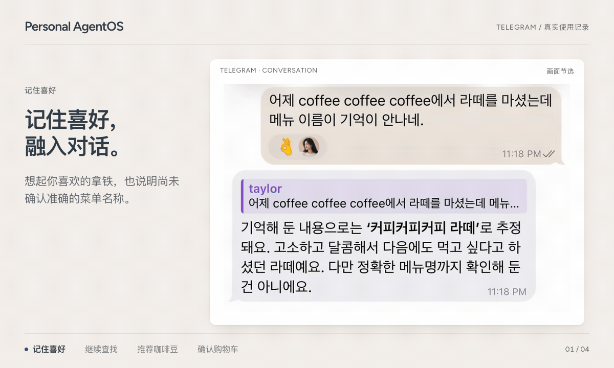
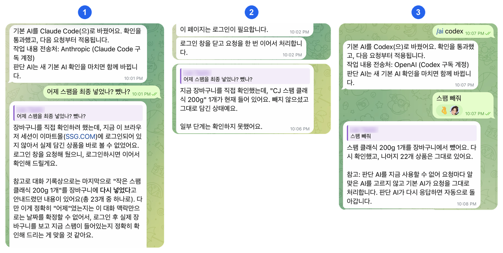
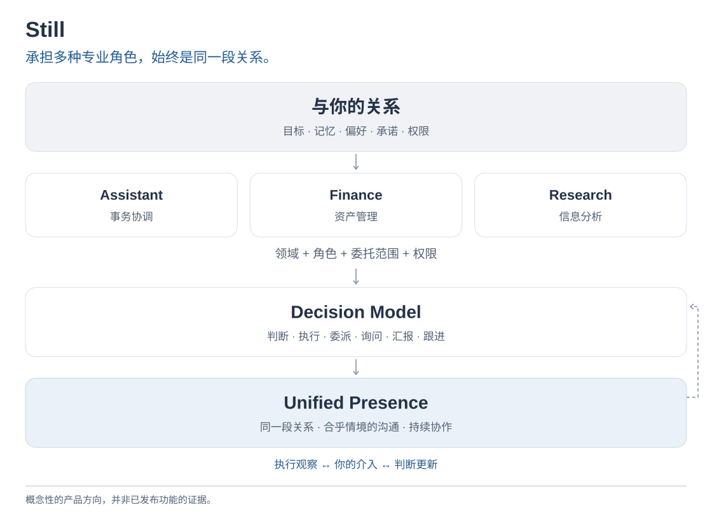
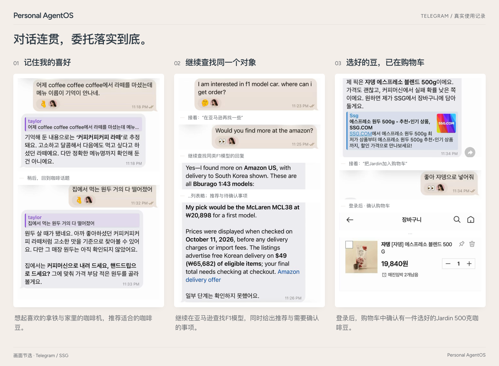

<div align="center">

<pre>
   ________________   __ 
  / __/_  __/  _/ /  / / 
 _\ \  / / _/ // /__/ /__
/___/ /_/ /___/____/____/
</pre>

**更换 AI，留下你的助手。**

安装在自己电脑上的开源个人助手。

[](https://github.com/Jongtae/Still/releases) [](https://github.com/Jongtae/Still/actions/workflows/validate.yml) [](../../docs/QUICKSTART.md) [](../../LICENSE)

[English](../../README.md) | [한국어](README.ko.md) | [简体中文](README.zh-CN.md) | [日本語](README.ja.md)

[试试看](#快速开始) · [目前能做什么](#目前能做什么) · [数据与权限](#留给你的东西) · [提供反馈](#文档) · [Engineering](https://jongtae.github.io/Still/engineering/zh-CN.html)

</div>

<!-- readme-parity:v1 -->

<!-- readme-section:hero -->

## 每换一个 AI，都要重新介绍自己吗？

你的偏好、昨天的对话、还没做完的事。想用更好的 AI，不应该意味着一切都要从头开始。

**Still 将记忆、进行中的工作和权限保存在你的电脑上，与实际执行任务的 AI 分开。** 你可以连接 Codex、Claude Code、模型 API 或 Ollama。干活的 AI 可以换，助手需要延续的上下文仍然留在你手里。

<p align="center">
  
</p>
<p align="center"><sub>由真实的 Telegram 和浏览器录屏剪辑而成。<a href="../../docs/assets/readme/demo/README.md">录制说明</a>。</sub></p>

<!-- readme-section:ai-switch -->

## 换了 AI，对话照样继续

下面的记录中，用户切换到 Claude Code 后，询问昨天的购物对话。之后换成 Codex，再说“把午餐肉拿掉”。Still 延续了同一段对话，而不是要求用户从头解释。

<details>
<summary>查看实际切换 AI 的对话</summary>

<p align="center">
  
</p>

登录链接已裁掉，姓名已模糊处理。[查看大图](../../docs/assets/readme/ai-switch/ai-switch-conversation.png) · [录制清单](../../docs/assets/readme/ai-switch/manifest.json)。

</details>

*这是经过剪辑的真实用户会话，界面为韩语。它展示对话延续，不是购物车变更的独立验证，也不能证明整个发行版的可重复性。*

<!-- readme-section:try-today -->

## 快速开始

你需要 **macOS、Linux 或使用 [WSL2](../../docs/QUICKSTART.md#windows-wsl2) 的 Windows**，以及一个配置好的 AI 连接：Codex、Claude Code、API，或已经运行的 Ollama。订阅方式需要相应的 CLI 使用资格和登录；AI 订阅、API 使用和模型下载与 Still 分开。详见 [AI 连接说明](../../docs/QUICKSTART.md#connect-an-ai)。

先检查[固定提交的安装脚本](https://github.com/Jongtae/Still/blob/33e12cea89fccad49118600ff47106e1c6f16350/scripts/install.sh)，再在 macOS、Linux 的终端或 WSL2 的 Ubuntu 内运行：

```sh
curl -LsSf https://raw.githubusercontent.com/Jongtae/Still/33e12cea89fccad49118600ff47106e1c6f16350/scripts/install.sh | sh
```

不必预先安装 Python、Homebrew 或 Docker。安装脚本会准备 Python 环境，并将发行归档的 SHA-256 与记录值核对。

在终端设置中选择 AI，随后直接对话，或在同一台电脑上打开 [http://127.0.0.1:8787/](http://127.0.0.1:8787/)。**无需一开始就连接邮箱、日历和聊天应用。**

### 先试一段小对话

贴入一段不含敏感信息的短文，问：**“用三句话概括这段内容。”** 接着说：**“保留重要日期，再短一点。”** 这些是建议的首次请求，不是引用实际测试结果的对话。检查回答是否正确、后续请求是否沿用了同一上下文，再尝试一件你确实需要帮助的低风险任务。

使用 Telegram 时，说“帮我连接 Telegram”，并按照配对步骤操作。机器人令牌只应输入专用的隐藏输入框，不能发在普通聊天消息中。

处理远程请求和定时任务时，需要保持 `agentos start` 运行，并让电脑保持唤醒。macOS 可用 `agentos service install` 注册登录时启动的后台服务；仅安装程序并不会自动注册服务。[运行与重启说明](../../docs/guide/operations.en.md#background-service-macos)。

<details>
<summary>在 Apple 芯片的 Mac 上使用 Homebrew</summary>

```sh
brew tap jongtae/still https://github.com/Jongtae/Still
brew install jongtae/still/agentos
agentos start
```

Intel Mac 请使用上面的一行安装命令。为保持兼容性，命令仍叫 `agentos`，启动的就是 Still。

</details>

**发布状态：** 两种安装方式安装的都是从已打标签的 main 提交构建的 **v0.7.0**（2026-11-13）。演示和日常使用画面来自真实使用会话，并非该发行版本的端到端验证；架构图属于产品方向。准确的发行范围与验证边界见 [release manifest](../../docs/release-manifest.json)。

设置、Windows 限制、更新与卸载：[QUICKSTART](../../docs/QUICKSTART.md)。

<!-- readme-section:capabilities -->

## 目前能做什么

| 你想做的事 | Still 提供的能力 |
| --- | --- |
| 不再重复解释，直接继续 | 将保存的记忆和之前的上下文用于后续请求；记住的内容可以查看和纠正。 |
| 换一个 AI | 用 `/ai` 切换已连接的 AI，同时保留 Still 的记忆和工作记录。 |
| 使用自己的资料 | 已连接的文件夹、Google Drive、Gmail 搜索和单独授权的邮箱整理，以及 Google Calendar。不支持 Gmail 发信。 |
| 在网站上获得帮助 | 在你登录的网站上使用浏览器工具。兼容性和登录要求因网站、平台而异。 |
| 工作中改变主意 | 任务进行时提出独立问题，或纠正正在处理的请求。 |
| 在习惯的地方对话 | 终端、浏览器、Telegram，以及 Slack、Mattermost 私信。 |

Still 仍在积极开发。先从小任务开始，需要时再添加连接。结果会受到模型、权限、服务配置和网站行为影响；这里并不保证所有任务都能在所有模型或网站上运行。[产品状态](../../docs/product-status.en.md)区分实现情况、观察到的使用结果和产品方向。准确的发行范围请以上面的 release manifest 为准。

<!-- readme-section:ownership -->

## 留给你的东西

AI 负责实际工作。Still 保存那些不该因更换 AI 而丢失的状态：**关于你的记忆和上下文、未完成的工作、权限与批准，以及执行记录。** 保留这些状态，不代表不同模型会给出相同答案或支持相同工具。

**本地优先（local-first）不等于只在本地（local-only）。** 使用外部 AI 时，请求需要的对话和上下文会发送给该提供方。连接远程服务，也不意味着 Still 能控制该服务的数据保留方式。先使用非敏感资料，只连接你打算使用的文件夹和账号。

### 权限与付款

连接的文件夹在未授予写入权限时保持只读。不同操作适用不同授权规则，因此连接服务后，并非每次变更都会再次单独确认。Still 为每项任务记录信息使用情况。密码和令牌应输入专用字段，而不是聊天消息。详见[安全与密钥处理](../../.github/SECURITY.md)。

**默认情况下，每笔付款都需要单独批准，自主付款模式默认关闭。** 主动开启后，AI 可以不再逐次询问就执行付款和资金转移，包括定时任务中的操作。启用期间，目前**没有金额、时间周期或各连接的额度上限**。首次试用请保持关闭。功能被收录进发行版，并不是已经验证真实付款或证券订单完整流程的证据。使用前请阅读 [release manifest](../../docs/release-manifest.json)。

<!-- readme-section:presence -->

## 工作原理

Still 将助手需要长期保持的状态与执行请求的 AI 分开。目标是始终延续同一段对话，而不是每换一个执行者或工具，就变成另一个助手。

不必先理解内部架构才能试用。[Engineering](https://jongtae.github.io/Still/engineering/zh-CN.html) 分别说明设计、实现和验证依据。

<details>
<summary>了解架构与产品方向</summary>

<picture>
  <source media="(max-width: 600px)" srcset="../../docs/assets/readme/presence-overview.zh-CN.narrow.svg">
  
</picture>

此图描述预期设计，不是实际运行记录，也不表示图中的每种角色都已作为专业智能体发布。[架构](../../docs/personal-agentos-architecture.en.md) · [Presence](../../docs/presence-experience-contract.en.md) · [为什么做 Still](../../docs/VISION.md)。

</details>

<!-- readme-section:conversation -->

## 日常使用

*节选自真实的 Telegram 对话画面（韩语界面），并配有简短的场景说明。*

这些记录展示了将咖啡偏好用于后续推荐、在亚马逊继续搜索 F1 模型，以及登录后回复所选咖啡豆的购物车状态。关于购物车的回复不是对账号状态的独立验证；加入购物车与付款是两种不同的操作。

<details>
<summary>查看更多真实对话片段</summary>

<picture>
  <source media="(max-width: 600px)" srcset="../../docs/assets/readme/readme-examples-v4.zh-CN.png">
  
</picture>

</details>

<!-- readme-section:engineering -->

## Engineering

想了解这种延续性如何实现，可以从 [Engineering](https://jongtae.github.io/Still/engineering/zh-CN.html) 和 [Research & Evidence](https://jongtae.github.io/Still/engineering/zh-CN.html#research) 开始。它们介绍记忆、判断、执行和所有者控制，并链接到代码与实验。设计、自动化测试和实际使用观察是不同类型的证据，不能互相替代。

<!-- readme-section:more -->

## 文档

[QUICKSTART](../../docs/QUICKSTART.md) · [产品状态](../../docs/product-status.en.md) · [文档地图](../../docs/README.md) · [贡献指南](../../.github/CONTRIBUTING.md) · [贡献者入门](../../docs/contributor-onboarding.en.md) · [致谢与参考](../../docs/acknowledgements.en.md)

### 试一件你自己的事，再告诉我们

Still 想知道的不只是演示能否成功，而是你会不会再用它。试一个低风险任务，告诉我们：**你在哪里卡住了？什么内容需要解释两遍？明天还想让它做什么？**

请使用[反馈表单](https://github.com/Jongtae/Still/issues/new?template=feedback.yml)或 [Discussions](https://github.com/Jongtae/Still/discussions)。平台、Still 版本、AI 连接方式和去除个人信息的例子会很有帮助。不要公开凭据、私人文档或登录链接。安全问题请按 [SECURITY.md](../../.github/SECURITY.md) 的说明报告，不要提交公开 Issue。

<!-- readme-section:license -->

## 许可证

[AGPL-3.0-only](../../LICENSE)。Still 的名称和标识适用 [TRADEMARKS.md](../../docs/TRADEMARKS.md)。
