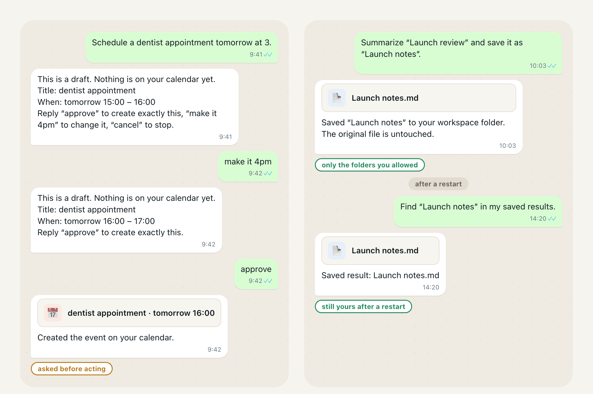
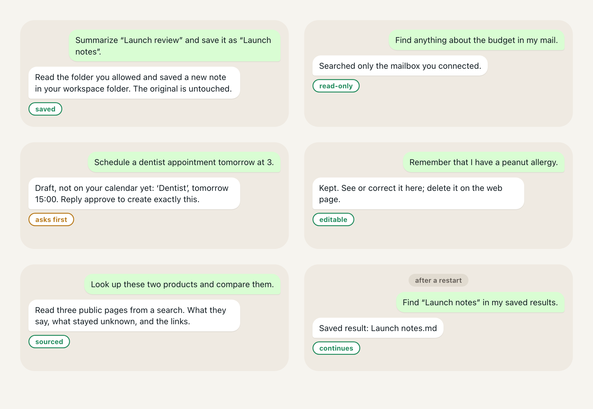

# Still product status

[Quick start](QUICKSTART.md) · [Operating guides](guide/operations.en.md) · [한국어](product-status.ko.md)

This page distinguishes **release coverage**, **newer source changes**, and **what was actually observed**. The current-status review below is dated 2026-11-05 and uses source revision `6edc3380b613ab0c2897ba7a913ab658150a68f4`. It is not an end-to-end test report.

## How to read the evidence

The [release manifest](release-manifest.json) records which changes a published build carries, the publication/package checks and the observations it does not claim. A merged implementation or passing fixture is not evidence of a live account operation. An owner recording establishes only what that recording shows, in its own environment and period. A design illustration establishes neither implementation nor operation.

Some original observations belong to the private predecessor `Jongtae/agentos`. Their links and issue numbers retain that provenance; they are not public Still issues with the same number. See [name compatibility](still-name-compatibility.en.md).

<!-- readme-section:demo-recording -->
## What the README recordings show

The main demo is edited from seven Telegram/browser recordings made on 2026-10-11 and selected for public use on 2026-10-12. It shows coffee preferences, an F1 model search continued on Amazon, a recommendation and a post-login cart reply. The [demo record](assets/readme/demo/README.md) preserves source digests and selected segments.

These are **edited screen recordings**, not an independent account-state or payment trace. They do not identify a build and model or establish release-wide repeatability. The separate [AI-switch recording manifest](assets/readme/ai-switch/manifest.json) documents conversation continuity across worker changes; that is not independent verification of every reported cart effect.

<!-- readme-section:status -->
## Current coverage and remaining limits

### In the published 0.5.0 release line

The table summarizes the manifest's recorded source coverage, including changes carried forward from earlier Still releases. **Included code is not the same as a verified live-service journey.**

| Capability | Recorded release coverage | Evidence and limits |
| --- | --- | --- |
| Install and first conversation | One-line installer or Apple silicon Homebrew; terminal setup leads into conversation. Telegram is optional. | Archive integrity and macOS formula installation/test are recorded. A clean installation on every supported platform and unattended operation after reboot are not established by those checks. |
| AI choice and conversation | Subscription CLIs or direct model connections; Telegram, Slack and Mattermost; mid-work corrections and an independent question while a Work runs. | Coverage is recorded from 0.3.0 onward. Route qualification and fixture checks do not prove equal behavior across models. Messenger observations have their own dated scope. |
| Memory | Attributable saved facts, stated/inferred provenance, correction and undo, and quiet daily consolidation. | The [memory experiments](research/memory-and-dream-experiments-2026-10-22-to-11-05.ko.md) are mostly offline replay with model judgments, not an overall live accuracy score. Later experiments and source changes are not automatically in this release. |
| Google services | Drive and Gmail reads; separately authorized Gmail organizing and filters; Calendar event changes through the API. | Gmail sending and forwarding filters are not supported. Calendar changes use a separate write connection and force no attendee email. The older draft/per-change approval flow was removed in 0.3.0; do not use the historical illustrations below as current instructions. |
| Scheduled preparations | Edit, pause, resume and run now; bounded recurring schedules and offered preparations. | Release coverage does not establish a preparation firing correctly over real days on an owner's machine. A proposal is not a running schedule until accepted. |
| Browser and phone sign-in | macOS WebKit, signed-in sessions, desktop-site choice and phone-input handoff improvements. | No universal shopping, inventory, checkout or website-compatibility claim. The release does not claim a live phone sign-in after the latest included changes. Linux Chromium support belongs to newer source. |
| Company use | Work mode, declared intranet hosts, cloud AI configuration and owner-confirmed MCP servers. | Company-network, cloud-provider and company-server operation are not established by the fixture/local checks. Work mode is not an air gap. |

Source: the `carries`, `observed` and `not_claimed` fields in the [manifest](release-manifest.json). Use [connections](guide/connections.en.md), [workplace](guide/workplace.en.md) and [platforms](guide/platforms.en.md) for the procedure and its scope, not the old issue chronology.

### Newer main source, not a new release

At the reviewed revision, main includes a Linux desktop Chromium browser path, peer-agent work under the current connection/delegation design, retirement of the old same-host family setup/sharing paths, and additional result/recovery fixes. These changes must not be advertised as included in the published build. The source version `0.5.1` is a placeholder, not a published tag or a selection of the next release version.

The [Linux platform guide](guide/platforms.en.md#browser-on-a-linux-desktop) states display, sandbox and keyring requirements and separates CI evidence from an owner's desktop session. For peer delegation, use the [current connection contract](connection-delegation-contract.en.md), not a retired family setup prompt. Current support still depends on the exact route, configuration and named tests or observations.

### Historical first-user audit — not today's capability list

The following table preserves the predecessor synthetic first-user audit [#472](https://github.com/Jongtae/agentos/issues/472), with injected transports; **live provider operation was not run**. Its failures and successes describe that earlier audit, not the latest release. Later fixes do not retroactively upgrade its evidence class, and old open-item wording is not an assertion that the same defect remains open today.

| Area | Evidence recorded in that audit |
| --- | --- |
| Install/start/restart | Local deterministic first-use path passed; clean-machine Homebrew/launchd operation was a separate gate. |
| Files | Synthetic **pass-with-friction**: quoted summary/save/reuse wording worked; natural save phrasing missed (#481). |
| Mail | Synthetic **pass-with-friction**: connect, re-auth, search and resume worked; reading a found mail in conversation remained a gap (#473, #478). |
| Calendar | Synthetic **pass-with-friction**: draft/create/correct/cancel/approve paths were tested; query and draft-approval gaps remained (#475, #482, #483). This is the historical draft design. |
| Research | Synthetic **pass-with-friction**: sourced known/unknown output worked; recommendation wording and post-file requests misrouted (#448, #474). |
| Memory | Synthetic **pass-with-friction**: remember, inspect, correct and held candidates worked; deletion was web-only (#479). |
| Honest results | The recorded Telegram/save fixes and remaining web/delegation gaps belonged to predecessor issues #476, #488, #489, #490, #493 and #494. |
| Agent distribution | Schemas and contracts existed; arbitrary third-party package execution and a public marketplace were not demonstrated. |

There is **no current claim** of autonomous purchasing, arbitrary computer use, universal web verification, live inventory/checkout verification, arbitrary third-party package execution or a public agent marketplace.

<!-- readme-section:release-illustrations -->
<a id="published-release-journey-illustrations"></a>
## Historical journey illustrations

These reconstructed v1 file and calendar scenes explain journeys with simulated services. They are not live-account screenshots or current setup instructions. In particular, the depicted Calendar draft/approval flow predates the API-based path described above.





<!-- readme-section:everyday-scene -->
## Product direction

<!-- capability:illustrative-product-direction -->

> **Product direction — not a current capability claim.**

> **You:** “Find our usual detergent or a suitable alternative, compare the full cost, and prepare the purchase. Ask before placing the order.”
>
> **Still:** gathers the allowed context, researches the options, separates what is known from what still needs verification, prepares the next step, and stops at the approval boundary.

**This scene is illustrative product direction, not a claim that autonomous shopping or checkout is shipped today.** A plausible conversation or a successful isolated action is not proof of the whole purchasing journey.

<!-- readme-section:delegation-flow -->
## Control during delegated work

The intended pattern is useful work under the owner's authority, followed by an honest account of the result. Current policy does **not** require the same confirmation before every write: owner-AI memory saves, authorized Calendar changes, third-party memory proposals and payments have different rules. The [Secretary Agency](secretary-agency-contract.en.md), [Owner Control](owner-control-contract.en.md) and [execution](assistant-execution-contract.en.md) documents define those distinctions. A requirement in a contract is not proof that every integration enforces it.

<!-- readme-section:chatbot-difference -->
## The design choice, without a market-wide comparison

Still aims to keep owner state independent of the AI doing the work. Evaluate that claim by asking whether a model change preserves the relevant memory, open work and permissions; whether the user can inspect and correct them; and whether reported effects match what happened. This is a testable design goal, not a claim that all hosted assistants retain only chat logs or that other products lack these capabilities.

<!-- readme-section:under-the-hood -->
## Architecture and ownership

The architecture separates these responsibilities:

`Owner · Context · Memory · Artifact · Capability · Runtime · Grant · Work · Event · Evidence`

The [owner-control contract](owner-control-contract.en.md) defines inspection, data and destination choice, bounded actions, revocation and portable owner state. Backup/restore excludes credentials, sign-in sessions and folder grants; those must be reconnected. Local installation does not mean external AI processing or remote service retention is under local control.

For future installable agents, `downloaded != installed != enabled != connected != authorized-for-action`. Package and marketplace designs remain subject to implementation and isolation evidence. Read the [concepts](concepts/README.md), [architecture](personal-agentos-architecture.en.md) and [platform foundation](agent-distribution-platform-foundation.en.md) for the rationale and requirements, not a list of shipped integrations.

<!-- readme-section:release -->
## The published release

**The Homebrew package installs the newest published release, `v0.6.0` (2026-11-07), from its tagged main commit.** The [release manifest](release-manifest.json) records source coverage and local installed checks.

The recorded tag commit is `6d26edfdaeb2f1204dc877d62fa9f9e25cf3059b`. Its archive digest and macOS formula checks do not establish live Google, messenger, shopping or reboot behavior. The owner-installed upgrade is not recorded for this release. See [Quick start](QUICKSTART.md) for the one-line installer, or use Homebrew on Apple silicon:

```sh
brew tap jongtae/still https://github.com/Jongtae/Still
brew install jongtae/still/agentos
agentos start
```

Publication follows the [release procedure](release.en.md); this page does not publish a build.

<!-- readme-section:license -->
## License

The code uses [AGPL-3.0-only](../LICENSE). The name and logo follow the [trademark notice](TRADEMARKS.md). Consult those texts for their terms.

<!-- readme-section:development -->
## Development and verification

Repository issue/branch/PR automation builds Still; it is not an end-user runtime capability. Start with [contributor onboarding](contributor-onboarding.en.md) and [CONTRIBUTING](../.github/CONTRIBUTING.md). CI establishes the checks it ran on its recorded revision, not the success of an unobserved owner task. Update this page from named implementation and evidence records, and update the Korean edition in the same change.
