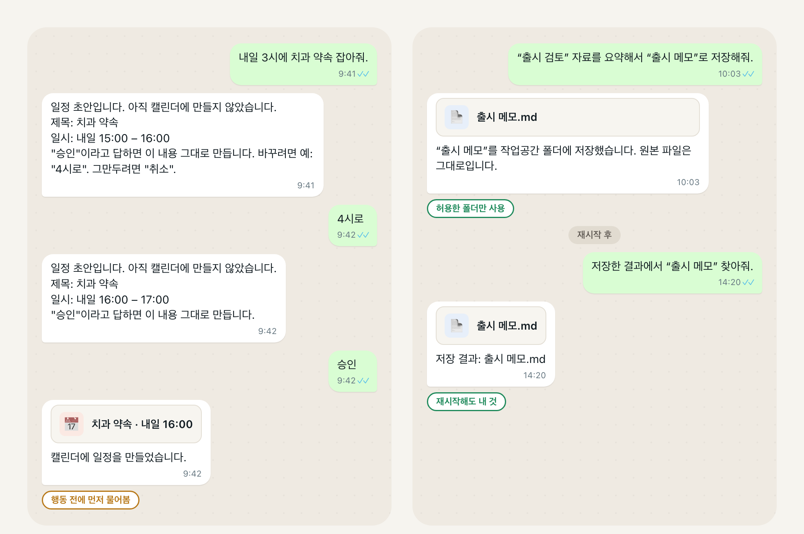
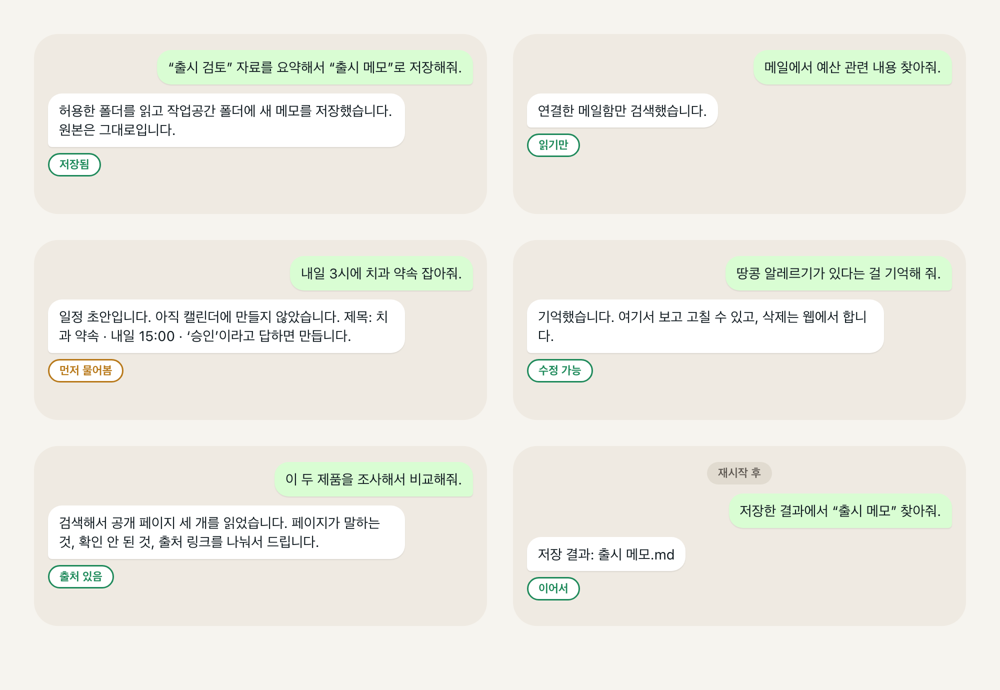

# Still 제품 현황

[빠른 시작](QUICKSTART.md) · [운영 안내](guide/operations.en.md) · [English](product-status.en.md)

이 페이지는 **배포본에 포함된 기능**, **이후 소스 변경**, **실제로 확인한 결과**를 구분한다. 아래 현황의 확인일은 2026-11-05이며, 소스 기준은 `6edc3380b613ab0c2897ba7a913ab658150a68f4`다. 전체 기능을 실제 서비스에서 검증한 보고서는 아니다.

## 근거를 읽는 기준

[배포 기록](release-manifest.json)은 각 버전에 포함된 변경, 배포·패키지 검사, 확인하지 못한 범위를 기록한다. 코드가 병합되었거나 모의 환경 테스트가 통과했다고 실제 계정에서 동작했다고 볼 수는 없다. 사용자 녹화는 그 환경과 시점에 화면으로 확인할 수 있는 범위의 근거다. 설계 그림은 구현이나 운영 결과를 입증하지 않는다.

일부 원래 관찰은 비공개 이전 저장소 `Jongtae/agentos`에 속한다. 그 링크와 이슈 번호는 당시의 출처를 유지하며, 같은 번호의 Still 이슈를 뜻하지 않는다. [이름 호환 안내](still-name-compatibility.en.md)를 참고하면 이 구분을 확인할 수 있다.

<!-- readme-section:demo-recording -->
## README 녹화가 보여 주는 것

주 데모는 2026-10-11의 Telegram·브라우저 녹화 일곱 개를 편집하고 2026-10-12에 공개용으로 고른 것이다. 커피 취향, 아마존으로 이어지는 F1 모형 검색, 추천, 로그인 뒤 장바구니에 관한 응답을 보여 준다. [데모 기록](assets/readme/demo/README.md)에 원본 해시와 편집 구간이 남아 있다.

이 자료는 **편집한 화면 녹화**이지 계정 상태나 결제의 독립 검증 기록이 아니다. 빌드와 모델을 특정하거나 배포본 전체의 반복 재현성을 입증하지도 않는다. 별도의 [AI 교체 녹화 기록](assets/readme/ai-switch/manifest.json)은 실행 AI를 바꾼 뒤 대화를 이어가는 모습을 담지만, 보고된 모든 장바구니 변경을 독립적으로 확인한 자료는 아니다.

<!-- readme-section:status -->
## 현재 범위와 확인이 필요한 부분

### 공개된 0.5.0 계열에 포함된 변경

이 표는 이전 Still 버전에서 이어받은 변경을 포함해 배포 기록의 소스 범위를 요약한다. **코드가 포함되었다는 사실과 실제 서비스 여정이 검증되었다는 사실은 다르다.**

| 기능 | 배포 기록상 포함 범위 | 근거와 한계 |
| --- | --- | --- |
| 설치와 첫 대화 | 한 줄 설치 또는 Apple silicon Homebrew. 터미널 설정 뒤 바로 대화하며 Telegram은 선택 사항이다. | 배포 파일 무결성과 macOS 포뮬러 설치·검사가 기록되어 있다. 모든 지원 환경의 새 설치나 재부팅 뒤 무인 운영을 입증하는 검사는 아니다. |
| AI 선택과 대화 | 구독 CLI 또는 직접 모델 연결, Telegram·Slack·Mattermost, 실행 중 정정과 별도 질문 처리. | 0.3.0부터 관련 변경이 기록되어 있다. 실행 경로 검사와 모의 테스트는 모델별 동작 품질이 같다는 증거가 아니다. 메신저 관찰도 각각의 날짜와 범위를 갖는다. |
| 기억 | 출처가 있는 사실 저장, 직접 말한 내용과 추론의 구분, 정정·되돌리기, 조용한 하루 단위 정리. | [기억 실험](research/memory-and-dream-experiments-2026-10-22-to-11-05.ko.md)은 대부분 오프라인 재생과 모델 판정이며 전체 실사용 정확도 점수가 아니다. 이후 실험과 소스 변경이 이 배포본에 자동으로 포함되는 것도 아니다. |
| Google 서비스 | Drive·Gmail 읽기, 별도 허용한 Gmail 정리·필터, Calendar API를 통한 일정 변경. | Gmail 발송과 전달 필터는 지원하지 않는다. 일정 변경에는 별도 쓰기 연결이 필요하며 참석자 이메일은 보내지 않는다. 예전 초안·건별 승인 흐름은 0.3.0에서 제거되었으므로 아래 역사 그림을 현재 사용법으로 읽으면 안 된다. |
| 예약된 준비 작업 | 수정·일시정지·재개·즉시 실행, 제한된 반복 일정과 준비 작업 제안. | 실제 사용자 환경에서 여러 날 반복 실행되었다는 검증까지 뜻하지 않는다. 제안은 수락되기 전에는 실행 일정이 아니다. 주인의 AI가 스스로 잡은 준비(먼저 하고 알리기, 하루 계획 #780)는 바로 예약되며 읽고 조사하고 보고하는 일만 한다. |
| 브라우저와 휴대전화 로그인 | macOS WebKit, 로그인 세션, 데스크톱 사이트 선택, 휴대전화 입력 연결 개선. | 모든 사이트의 쇼핑·재고·결제·호환성을 보장하지 않는다. 배포 기록은 최신 포함 변경 뒤의 실제 휴대전화 로그인 관찰을 주장하지 않는다. Linux Chromium은 이후 소스 변경이다. |
| 회사 환경 | 회사 모드, 지정한 사내 호스트, 클라우드 AI 설정, 사용자가 확인한 MCP 서버. | 모의·로컬 검사는 실제 회사 네트워크·클라우드 제공자·회사 서버에서의 운영을 입증하지 않는다. 회사 모드는 망 분리가 아니다. |

근거는 [배포 기록](release-manifest.json)의 `carries`, `observed`, `not_claimed` 항목이다. 절차와 적용 범위는 과거 이슈 순서 대신 [연결](guide/connections.en.md), [회사 환경](guide/workplace.en.md), [플랫폼](guide/platforms.en.md) 안내에서 확인한다.

### 이후 main 소스 변경: 새 배포본은 아님

확인한 소스에는 Linux 데스크톱용 Chromium 브라우저, 현재 연결·위임 설계에 따른 다른 에이전트와의 작업, 예전 동일 호스트 가족 설정·공유 경로의 제거, 추가 결과·복구 수정이 들어 있다. 이를 공개 배포본에 포함된 기능으로 안내해서는 안 된다. 소스의 `0.5.1`은 다음 개발 버전의 자리표시자이며, 공개 태그나 다음 배포 버전의 확정이 아니다.

[Linux 안내](guide/platforms.en.md#browser-on-a-linux-desktop)는 화면 세션·샌드박스·키 저장소 요건을 설명하고 CI 근거와 실제 사용자 데스크톱 관찰을 구분한다. 에이전트 간 위임은 폐기된 가족 설정 지시가 아니라 [현재 연결 기준 문서](connection-delegation-contract.en.md)를 따른다. 지원 여부는 정확한 실행 경로·설정·명시된 테스트나 관찰로 판단해야 한다.

### 과거 첫 사용자 감사: 현재 기능표가 아님

아래는 이전 저장소의 synthetic first-user audit [#472](https://github.com/Jongtae/agentos/issues/472)를 보존한 요약이다. 모의 통신 수단을 주입한 검사이며, **실제 외부 제공자 운영은 실행하지 않았습니다.** 성공과 실패는 당시 검사에 관한 기록이지 최신 배포본의 상태가 아니다. 이후 수정이 그 검사의 증거 수준을 바꾸지 않으며, 당시 미해결 항목이 지금도 열려 있다는 뜻도 아니다.

| 영역 | 당시 기록된 근거 |
| --- | --- |
| 설치·시작·재시작 | 로컬의 결정적 첫 사용 경로를 통과했다. 새 기기의 Homebrew·launchd 운영은 별도 관문이었다. |
| 파일 | Synthetic **pass-with-friction**. 지정한 요약·저장·재사용 문구는 동작했고, 자연스러운 저장 표현은 놓쳤다(#481). |
| 메일 | Synthetic **pass-with-friction**. 연결·재인증·검색·재개는 동작했지만 찾은 메일을 대화에서 읽는 경로가 남아 있었다(#473, #478). |
| 일정 | Synthetic **pass-with-friction**. 초안·생성·정정·취소·승인 경로를 검사했고, 조회와 초안 승인에 빈틈이 있었다(#475, #482, #483). 과거 초안 설계의 기록이다. |
| 조사 | Synthetic **pass-with-friction**. 출처가 있는 확인·미확인 결과는 동작했지만 추천 표현과 파일 읽기 직후 요청을 잘못 분류했다(#448, #474). |
| 기억 | Synthetic **pass-with-friction**. 기억·조회·정정·보류 후보는 동작했고, 삭제는 웹에서만 가능했다(#479). |
| 정직한 결과 | 당시 Telegram·저장 수정과 웹·위임의 남은 문제는 이전 저장소 #476, #488, #489, #490, #493, #494의 기록이다. |
| 에이전트 배포 | 스키마와 기준 문서가 있었지만 임의의 제3자 패키지 실행과 공개 마켓플레이스는 입증되지 않았다. |

자율 구매, 임의의 컴퓨터 사용, 범용 웹 검증, 실시간 재고·결제 검증, 임의의 제3자 패키지 실행, 공개 에이전트 마켓플레이스에 대한 **현재 주장은 없다.**

<!-- readme-section:release-illustrations -->
<a id="공개-배포본의-여정-설명"></a>
## 과거 여정 설명 그림

모의 서비스를 사용한 v1 파일·일정 여정을 재구성한 그림이다. 실제 계정 화면이나 현재 설정 안내가 아니다. 특히 그림의 일정 초안·승인 흐름은 위에서 설명한 API 기반 경로보다 앞선 설계다.





<!-- readme-section:everyday-scene -->
## 제품 방향

<!-- capability:illustrative-product-direction -->

> **Product direction — 현재 지원 기능을 뜻하지 않습니다.**

> **나:** “평소 쓰던 세제나 괜찮은 대안을 찾아서 전체 비용을 비교하고 구매 준비해줘. 주문하기 전에는 물어봐.”
>
> **Still:** 허용된 맥락을 사용하고 근거를 비교하며, 다음 행동을 준비하고 적용되는 승인 경계를 지킨다.

**이 장면은 product direction을 설명하기 위한 예시이며, 현재 자율 구매나 결제가 제공된다는 뜻이 아닙니다.** 그럴듯한 대화나 개별 동작의 성공만으로 전체 구매 여정이 검증되지는 않는다.

<!-- readme-section:delegation-flow -->
## 일을 맡기는 동안의 통제

지향하는 것은 사용자 권한 안에서 유용한 일을 하고, 결과를 사실대로 알리는 경험이다. 현재 정책이 **모든 쓰기 동작 전에 동일한 확인을 요구하는 것은 아니다.** 사용자 자신의 AI가 기억을 저장하는 경우, 허용된 일정 변경, 제3자의 기억 제안, 결제는 서로 다른 규칙을 따른다. [Secretary Agency](secretary-agency-contract.en.md), [Owner Control](owner-control-contract.en.md), [실행 기준](assistant-execution-contract.en.md)이 그 구분을 정의한다. 문서의 요구사항은 모든 연결에서 집행되었다는 증거와 다르다.

<!-- readme-section:chatbot-difference -->
## 다른 제품 전체를 단정하지 않고 비교하기

Still은 일을 수행하는 AI와 사용자 상태를 분리하려 한다. 모델을 바꿔도 관련 기억·진행 중인 일·권한이 유지되는지, 사용자가 이를 확인하고 고칠 수 있는지, 보고한 결과가 실제 변화와 맞는지로 평가해야 한다. 이는 검증할 설계 목표이지, 모든 호스팅 비서에는 대화 기록만 남거나 다른 제품에는 이런 기능이 없다는 주장이 아니다.

<!-- readme-section:under-the-hood -->
## 구조와 소유

아키텍처는 다음 책임을 구분한다.

`Owner · Context · Memory · Artifact · Capability · Runtime · Grant · Work · Event · Evidence`

[사용자 통제 기준](owner-control-contract.en.md)은 확인, 데이터·목적지 선택, 행동 범위, 권한 회수, 사용자 상태 이전을 정의한다. 백업·복원에서 자격 증명·로그인 세션·폴더 허용은 제외되므로 다시 연결해야 한다. 로컬 설치라고 외부 AI 처리와 원격 서비스의 보관까지 로컬에서 통제하는 것은 아니다.

향후 설치형 에이전트에도 `downloaded != installed != enabled != connected != authorized-for-action`이라는 구분이 적용된다. 패키지·마켓플레이스 설계에는 별도의 구현·격리 근거가 필요하다. [개념 해설](concepts/README.md), [아키텍처](personal-agentos-architecture.en.md), [플랫폼 설계](agent-distribution-platform-foundation.en.md)는 이유와 요구사항을 설명하며 출시된 연동 목록을 대신하지 않는다.

<!-- readme-section:release -->
## 공개 배포본

**Homebrew 패키지는 태그가 붙은 main 커밋의 최신 공개 배포본 `v0.7.0`(2026-11-13)을 설치합니다.** [release manifest](release-manifest.json)에 포함 소스와 로컬 설치 검증을 기록했습니다.

기록된 태그 커밋은 `6d26edfdaeb2f1204dc877d62fa9f9e25cf3059b`다. 배포 파일의 해시와 macOS 포뮬러 검사는 실제 Google·메신저·쇼핑 사용이나 재부팅 뒤 동작을 입증하지 않는다. 이 배포본의 사용자 설치 업그레이드는 아직 기록되지 않았다. 한 줄 설치는 [빠른 시작](QUICKSTART.md)을 따르며, Apple silicon의 Homebrew 설치는 다음과 같다.

```sh
brew tap jongtae/still https://github.com/Jongtae/Still
brew install jongtae/still/agentos
agentos start
```

배포는 [배포 절차](release.en.md)를 따른다. 이 페이지 수정은 새 빌드를 공개하는 작업이 아니다.

<!-- readme-section:license -->
## 라이선스

코드는 [AGPL-3.0-only](../LICENSE)를 사용한다. 이름과 로고에는 [상표 고지](TRADEMARKS.md)가 적용된다. 구체적인 조건은 원문을 따른다.

<!-- readme-section:development -->
## 개발과 검증

이슈·브랜치·PR 자동화는 Still을 만드는 도구이지 사용자를 위한 실행 기능이 아니다. 개발은 [기여자 안내](contributor-onboarding.en.md)와 [CONTRIBUTING](../.github/CONTRIBUTING.md)에서 시작한다. CI는 기록된 리비전에서 수행한 검사를 입증할 뿐 관찰하지 않은 사용자 과제의 성공을 입증하지 않는다. 현황을 수정할 때는 구현과 근거를 명시하고 영어판과 한국어판을 함께 갱신한다.
